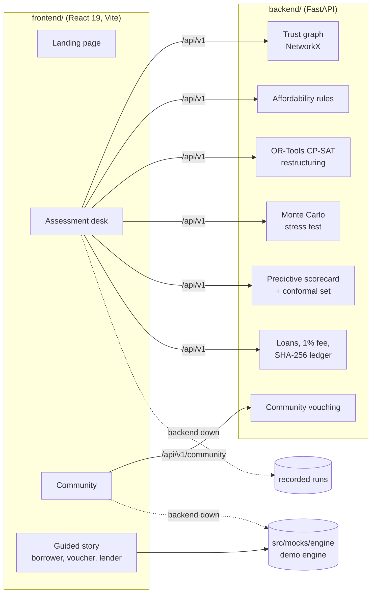

# VeriTrust

<!-- BEGIN:overview -->
<p align="center">
  
</p>

<p align="center">
  <b>Vouch</b> (code name VeriTrust) gives lenders fair, explainable evidence about people a credit bureau cannot see.<br>
  <a href="https://3-110-225-114.sslip.io">Live demo</a> ·
  <a href="docs/DEMO.md">Demo script</a> ·
  <a href="docs/ARCHITECTURE.md">Architecture</a> ·
  <a href="docs/API_CONTRACT.md">API contract</a> ·
  <a href="docs/FRONTEND_FALLBACK.md">Offline fallback</a>
</p>

<p align="center">
  
  
  
  
  
  
</p>

**The problem.** A credit score alone cannot see three things:

| | What the score misses | The number |
|---|---|---|
| 1 | **No score is not a bad score.** A thin file is read as risk. | 19% of 150,000 people in a CIBIL–CSC programme had no numerical CIBIL Score ([TransUnion CIBIL](https://newsroom.transunion.in/transunion-cibil-and-csc-partnership-benefits-15-lakh-consumers-in-first-year/)) |
| 2 | **Years of paying on time, undone by one emergency.** One late month outweighs 35 good ones. | 50–80 points off a CIBIL Score for a single payment 30 days late ([Bajaj Housing Finance](https://www.bajajhousingfinance.in/resources/how-does-missing-payment-affect-cibil-score)) |
| 3 | **A no without a reason.** People are turned down and never told why. | 45% of 1,000+ people surveyed had never checked their score; about one in three were rejected for a poor or missing history ([ZET, via The Economic Times](https://economictimes.indiatimes.com/industry/banking/finance/banking/nearly-half-of-indian-consumers-never-checked-their-credit-score-zet-study/articleshow/123948262.cms)) |

**What Vouch does.** It sits beside the bureau, not in place of it. People who know a borrower stake their own reputation on them; the loan is checked against real cash flow and stress-tested; and four signals (bureau, Vouch Score, affordability, evidence) are shown apart, each with its source, never blended into one verdict. A missing file is recorded as unknown, not bad. The lender decides.

| Assessment desk, on the live backend | Every figure explains itself |
|---|---|
|  |  |
| **Predictive view with a conformal set** | **The problem, with sources** |
|  |  |
| **Community: vouch for people you know, or a verified stranger** | **Every vouch shows its weight and what you can win or lose** |
|  |  |
| **Two axes, never one number** | **A default slashes sponsors, damped, and stops at two hops** |
|  |  |

<sub>Screens use illustrative seed data. Not financial advice.</sub>
<!-- END:overview -->

<!-- BEGIN:quickstart -->
Run the backend and the frontend in two terminals.

```bash
# Backend: FastAPI on http://localhost:8000 (interactive docs at /docs)
cd backend
python -m venv .venv && source .venv/bin/activate   # Windows: .venv\Scripts\activate
pip install -r requirements.txt
python main.py serve --port 8000
```

```bash
# Frontend: Vite on http://localhost:5173
cd frontend
npm ci
npm run dev
```

The frontend proxies API calls to `VITE_API_BASE_URL` (default `http://localhost:8000`; see `.env.example`). With no backend running, every screen still works on recorded and demo data under a "demo data" badge ([how](docs/FRONTEND_FALLBACK.md)). Both together: `docker compose up`.

Checks:

```bash
cd backend && pytest          # 159 pass, 1 skip without the ML packages; rewrites data/store.json, so `git checkout` it after
cd frontend && npx vitest run # 43 pass
make check                    # what CI runs: structure, docs, lint, frontend and script tests, README table
make hooks                    # once per clone: the pre-push docs gate
```
<!-- END:quickstart -->

<!-- BEGIN:features -->
Vouch combines explainable affordability analysis, Web-of-Trust reputation, stress-tested loan restructuring, and community-backed lending for people traditional credit scores cannot see.
<!-- END:features -->

<!-- BEGIN:architecture -->


- **Trust graph.** Vouches are directed, weighted edges. A voucher's capacity is bounded by their reputation and split across everyone they back, a path that loops back on itself counts zero, and trust fades with each hop, so a ring cannot vouch itself up.
- **Two axes, never one number.** Expected capacity μ and uncertainty σ² are kept apart; the lendable score is the lower bound μ − √σ². No data means high σ², never a bad score.
- **Affordability.** Disposable income after essentials, existing EMIs and a protected cash buffer, capped at 40% of income for the instalment and 50% for all debt. OR-Tools CP-SAT searches amount and tenure for a plan that fits; a seeded Monte Carlo run of 2,000 to 5,000 futures stress-tests it.
- **Default cascade.** A default slashes the borrower, then direct sponsors (damped by their edge weight), then their sponsors, and stops there. A cluster breaker queues slashes once more than 30% of a cluster has defaulted.
- **Explainable by construction.** Every reason cites its source, every hover shows the formula behind the figure (`frontend/src/features/explain/formulas.ts`), and money is `Decimal` end to end.

The assessment desk and community run on the backend; the guided story runs on the in-browser demo engine (`frontend/src/mocks/engine/`), which mirrors the protocol maths. Full specification: [docs/ARCHITECTURE.md](docs/ARCHITECTURE.md). Formulas and constants: [backend/localdocs/FORMULAS_AND_NUMBERS.md](backend/localdocs/FORMULAS_AND_NUMBERS.md). Endpoints: [docs/API_CONTRACT.md](docs/API_CONTRACT.md).
<!-- END:architecture -->

<!-- BEGIN:team -->
<!-- END:team -->

<!-- BEGIN:demo -->
[Live demo](https://3-110-225-114.sslip.io) · See the presenter script and fallback modes in [docs/DEMO.md](docs/DEMO.md).
<!-- END:demo -->

---
New to this repo? Read [docs/REPO_GUIDE.md](docs/REPO_GUIDE.md) for why every folder and file exists.
