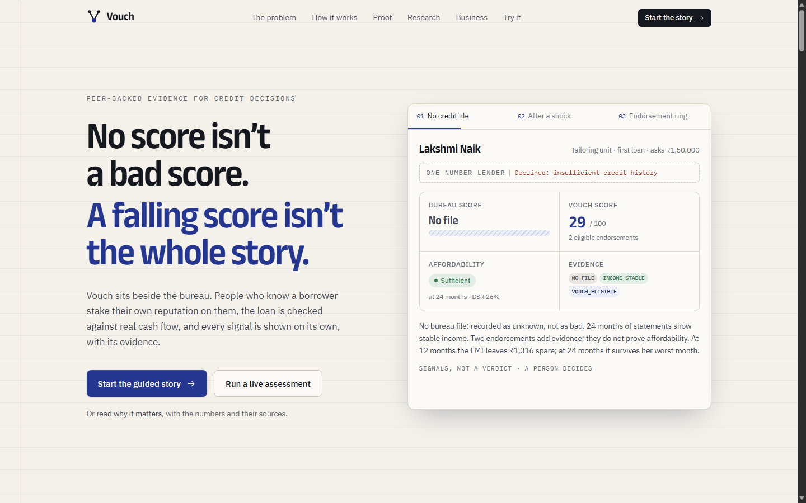
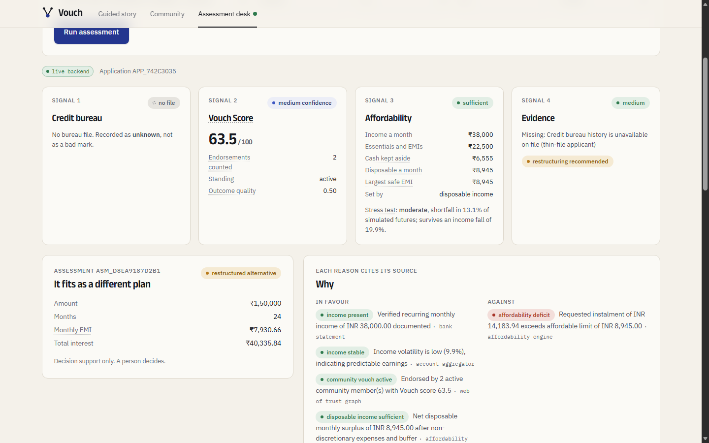
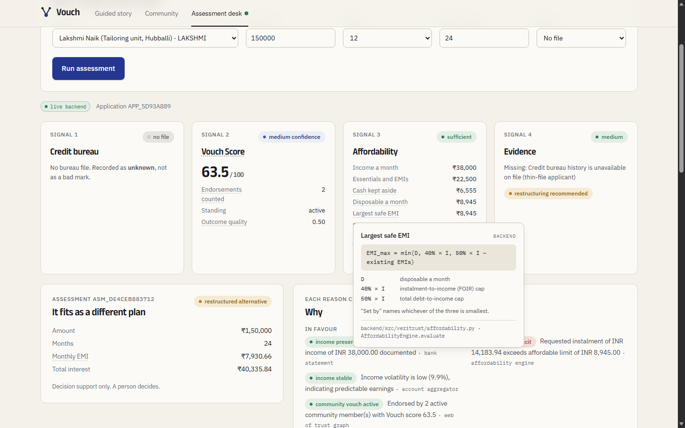
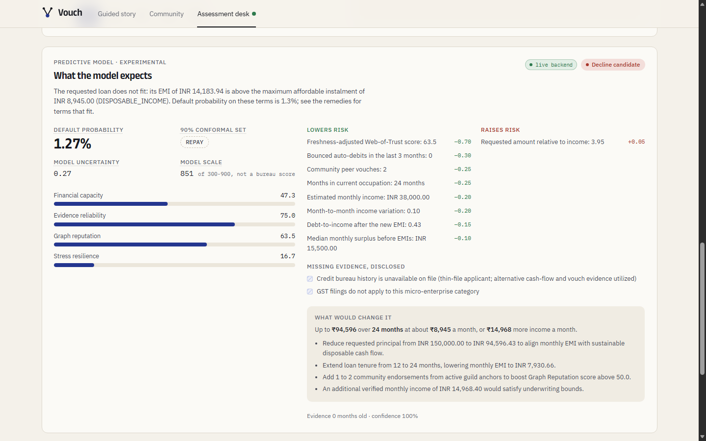
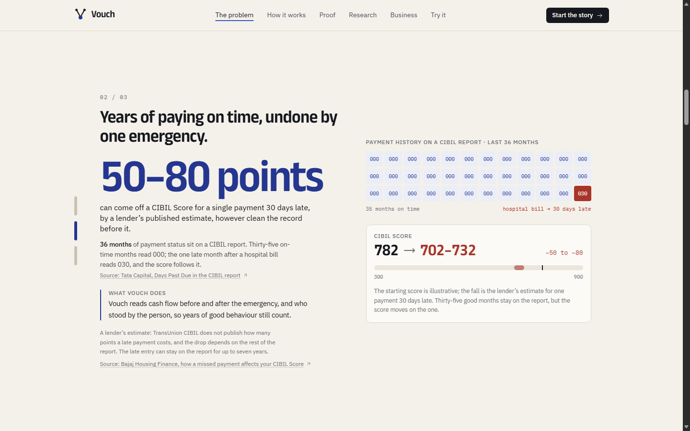
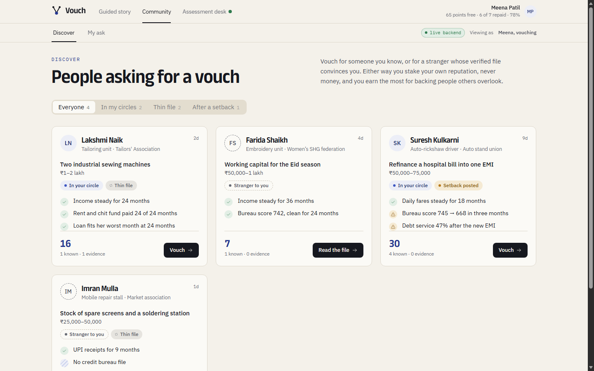
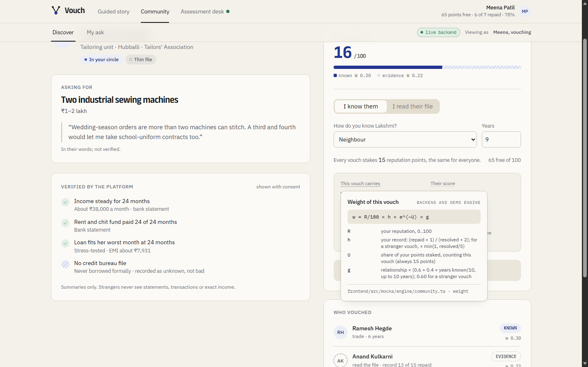
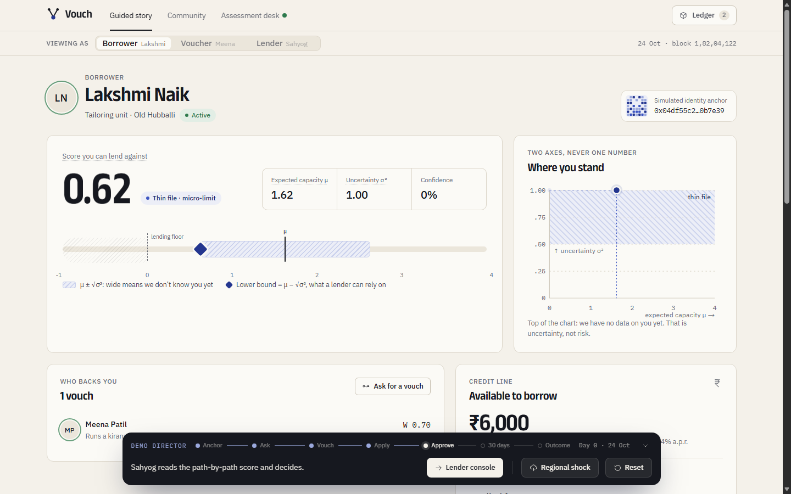
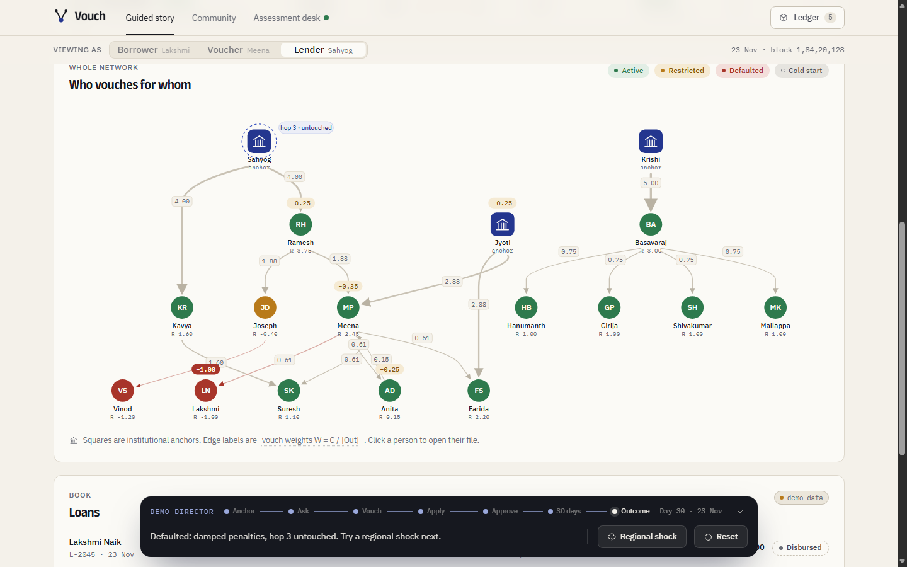
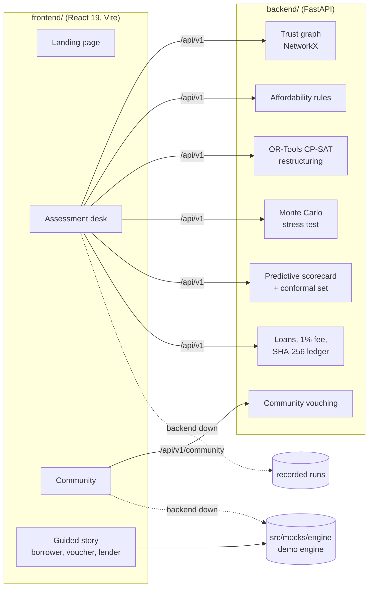

# VeriTrust

> PLACEHOLDER. Edit only through `/readme`, and only inside the marker sections.

<!-- BEGIN:overview -->
<p align="center">
  
</p>

<p align="center">
  <b>Vouch</b> (code name VeriTrust) gives lenders fair, explainable evidence about people a credit bureau cannot see.<br>
  <a href="https://3-110-225-114.sslip.io">Live demo</a> ·
  <a href="docs/DEMO.md">Demo script</a> ·
  <a href="docs/ARCHITECTURE.md">Architecture</a> ·
  <a href="docs/API_CONTRACT.md">API contract</a> ·
  <a href="docs/FRONTEND_FALLBACK.md">Offline fallback</a>
</p>

<p align="center">
  
  
  
  
  
  
</p>

**The problem.** A credit score alone cannot see three things:

| | What the score misses | The number |
|---|---|---|
| 1 | **No score is not a bad score.** A thin file is read as risk. | 19% of 150,000 people in a CIBIL–CSC programme had no numerical CIBIL Score ([TransUnion CIBIL](https://newsroom.transunion.in/transunion-cibil-and-csc-partnership-benefits-15-lakh-consumers-in-first-year/)) |
| 2 | **Years of paying on time, undone by one emergency.** One late month outweighs 35 good ones. | 50–80 points off a CIBIL Score for a single payment 30 days late ([Bajaj Housing Finance](https://www.bajajhousingfinance.in/resources/how-does-missing-payment-affect-cibil-score)) |
| 3 | **A no without a reason.** People are turned down and never told why. | 45% of 1,000+ people surveyed had never checked their score; about one in three were rejected for a poor or missing history ([ZET, via The Economic Times](https://economictimes.indiatimes.com/industry/banking/finance/banking/nearly-half-of-indian-consumers-never-checked-their-credit-score-zet-study/articleshow/123948262.cms)) |

**What Vouch does.** It sits beside the bureau, not in place of it. People who know a borrower stake their own reputation on them; the loan is checked against real cash flow and stress-tested; and four signals (bureau, Vouch Score, affordability, evidence) are shown apart, each with its source, never blended into one verdict. A missing file is recorded as unknown, not bad. The lender decides.

| Assessment desk, on the live backend | Every figure explains itself |
|---|---|
|  |  |
| **Predictive view with a conformal set** | **The problem, with sources** |
|  |  |
| **Community: vouch for people you know, or a verified stranger** | **Every vouch shows its weight and what you can win or lose** |
|  |  |
| **Two axes, never one number** | **A default slashes sponsors, damped, and stops at two hops** |
|  |  |

<sub>Screens use illustrative seed data. Not financial advice.</sub>
<!-- END:overview -->

<!-- BEGIN:quickstart -->
Run the backend and the frontend in two terminals.

```bash
# Backend: FastAPI on http://localhost:8000 (interactive docs at /docs)
cd backend
python -m venv .venv && source .venv/bin/activate   # Windows: .venv\Scripts\activate
pip install -r requirements.txt
python main.py serve --port 8000
```

```bash
# Frontend: Vite on http://localhost:5173
cd frontend
npm ci
npm run dev
```

The frontend proxies API calls to `VITE_API_BASE_URL` (default `http://localhost:8000`; see `.env.example`). With no backend running, every screen still works on recorded and demo data under a "demo data" badge ([how](docs/FRONTEND_FALLBACK.md)). Both together: `docker compose up`.

Checks:

```bash
cd backend && pytest          # 159 pass, 1 skip without the ML packages; rewrites data/store.json, so `git checkout` it after
cd frontend && npx vitest run # 43 pass
make check                    # what CI runs: structure, docs, lint, frontend and script tests, README table
make hooks                    # once per clone: the pre-push docs gate
```
<!-- END:quickstart -->

<!-- BEGIN:features -->
| Feature | Status | Assignee | What it does |
|---|---|---|---|
| Assessment desk | in-progress | Reehan | The first screen on the real FastAPI backend (`/app/assess`): pick a backend applicant, run the assessment, and see bureau, Vouch Score, affordability and evidence apart, with the best plan, a stress test, cited reasons and what-if sliders re-checked by `/scenarios`; beside it the predictive model's view (`/predict`: decision with a 90% conformal set, default probability, reasons, missing evidence, remedy); then the lender approves or declines (`/decision`), which puts a real loan on the book; when the backend is down or a call fails it shows a recorded run of the same backend (`src/mocks/deskRecorded.ts`) under a demo-data badge instead of an error; every figure with a dotted label opens the formula behind it, its terms and the file that computes it (`src/features/explain/formulas.ts`) |
| Borrower dashboard | in-progress | Reehan | See a two-axis score, ask for a vouch and borrow |
| Community | in-progress | Reehan | Hybrid vouching platform: borrowers post an ask and choose what strangers may see; anyone can vouch, always staking the same platform-set 15 reputation points (no stake slider), as someone who knows them (KNOWN) or as a stranger who read their verified summary (EVIDENCE, weighted by the voucher's track record and capped); vouchers stand by or step back after a setback; live on `/api/v1/community` when the backend answers (vouches, previews, stand-by and what strangers see all go to the server), demo data when it does not, with a badge saying which; every figure with a dotted label opens the formula behind it, its terms and the file that computes it (`src/features/explain/formulas.ts`) |
| Default cascade | in-progress | Reehan | Watch a default slash sponsors and stop at two hops |
| Demo director | in-progress | Reehan | Drive the demo story from one presenter bar |
| Identity onboarding | in-progress | Reehan | Sign in with a demo Aadhaar and get a simulated identity anchor |
| Landing page | in-progress | Reehan | Vouch in one screen: a live assessment cycling three cases (no file, a shock, an endorsement ring) with bureau, Vouch, affordability and evidence shown apart; three pain points with sourced figures (no score is not a bad score; years of on-time payments undone by one emergency, shown as a CIBIL report's 36-month payment history and a 50-80 point fall; a no without a reason), pinned while the reader scrolls; a four-step flow of how Vouch works with close-up tabs; three animated tests from our dataset (real Prosper loans by score band, simulated shocked borrowers split by vouch, default by vouch strength); the research for and against the idea; a business-model section (who pays whom under institution-owned and platform deployment, with each model's planning prices), each figure linked to its source; then a Vouch Score builder, a loan stress test and an explanation split into observed, reported, inferred and missing; a sticky section nav and a closing guide to the three ways in (guided story, community, Assessment desk) |
| Lender console | in-progress | Reehan | Rank applicants on both axes and read the trust graph; when the backend is live, a live book of its loans with repay and default (showing the damped cascade), the platform treasury and recent transactions; offline, a "demo data" line with Try again in its place; every figure with a dotted label opens the formula behind it, its terms and the file that computes it (`src/features/explain/formulas.ts`) |
| Mathematical trust framework | done | Abhijit | Chronological rank-based diminishing returns alpha_uv = 1 / 2^(r-1), hop decay delta, min-path same-source consolidation, diminishing repeat transaction minting, and atomic snapshot default penalties |
| Platform treasury and transaction fees | done | Abhijit | Collects an auditable 1.0% fee cut on all loan disbursements and repayments, tracked on every Transaction model, accumulated in a dedicated Platform Treasury, and exposed via REST and CLI |
| Dual-axis underwriting engine | done | Abhishek | Four-signal credit assessment combining rule-based cash-flow affordability (D = I - E - B), Google OR-Tools CP-SAT loan restructuring, Web-of-Trust graph credibility propagation, and Monte Carlo stress testing |
| Vouching | in-progress | Reehan | See what a vouch costs you, then hold to vouch |
<!-- END:features -->

<!-- BEGIN:architecture -->


- **Trust graph.** Vouches are directed, weighted edges. A voucher's capacity is bounded by their reputation and split across everyone they back, a path that loops back on itself counts zero, and trust fades with each hop, so a ring cannot vouch itself up.
- **Two axes, never one number.** Expected capacity μ and uncertainty σ² are kept apart; the lendable score is the lower bound μ − √σ². No data means high σ², never a bad score.
- **Affordability.** Disposable income after essentials, existing EMIs and a protected cash buffer, capped at 40% of income for the instalment and 50% for all debt. OR-Tools CP-SAT searches amount and tenure for a plan that fits; a seeded Monte Carlo run of 2,000 to 5,000 futures stress-tests it.
- **Default cascade.** A default slashes the borrower, then direct sponsors (damped by their edge weight), then their sponsors, and stops there. A cluster breaker queues slashes once more than 30% of a cluster has defaulted.
- **Explainable by construction.** Every reason cites its source, every hover shows the formula behind the figure (`frontend/src/features/explain/formulas.ts`), and money is `Decimal` end to end.

The assessment desk and community run on the backend; the guided story runs on the in-browser demo engine (`frontend/src/mocks/engine/`), which mirrors the protocol maths. Full specification: [docs/ARCHITECTURE.md](docs/ARCHITECTURE.md). Formulas and constants: [backend/localdocs/FORMULAS_AND_NUMBERS.md](backend/localdocs/FORMULAS_AND_NUMBERS.md). Endpoints: [docs/API_CONTRACT.md](docs/API_CONTRACT.md).
<!-- END:architecture -->

<!-- BEGIN:team -->
- Abhishek: repo setup, architecture, review and merge
- Reehan: frontend app, community platform and landing page
- Abhijit: backend credit engine, mathematical framework and platform treasury
<!-- END:team -->

<!-- BEGIN:demo -->
[Live demo](https://3-110-225-114.sslip.io) · presenter script and fallbacks in [docs/DEMO.md](docs/DEMO.md).

1. **No file, not a bad file.** Lakshmi, a tailor with no bureau history, asks for 1,50,000 INR. The desk shows bureau "unknown", a Vouch Score of 63.5 from two vouchers, 8,945 INR a month to spare, and a restructured 24-month plan that fits where 12 months does not.
2. **Vouching with skin in the game.** In the community, a voucher stakes a fixed 15 reputation points and sees the weight the vouch carries, the score change, and what they win or lose on the outcome.
3. **Default, damped.** The guided story walks Lakshmi from sign-in to a loan, then a default: penalties fall on her sponsors and their sponsors, and stop at hop 3.
<!-- END:demo -->

---
New to this repo? Read [docs/REPO_GUIDE.md](docs/REPO_GUIDE.md) for why every folder and file exists.
