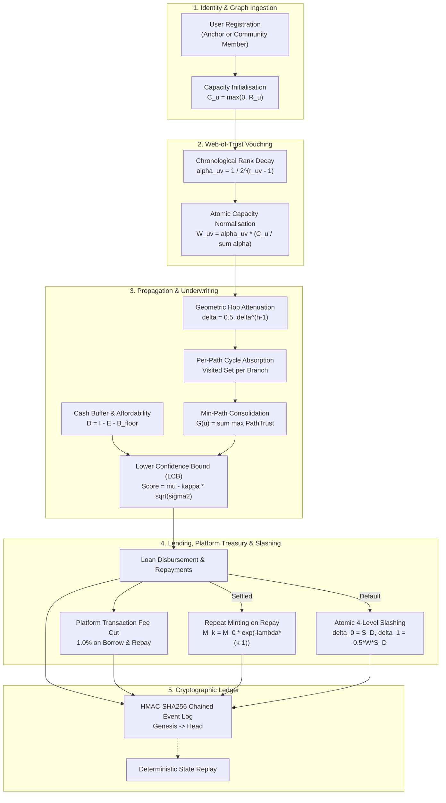
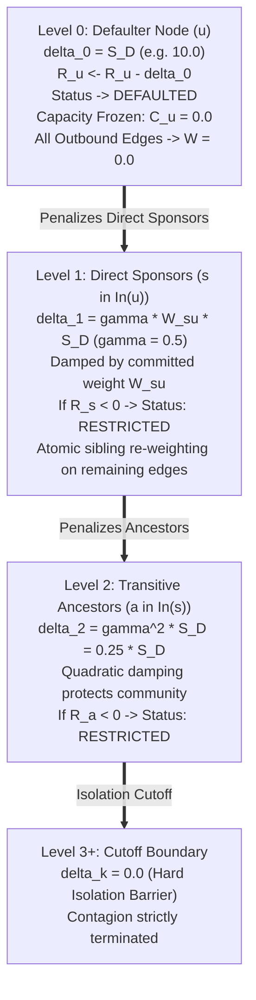

# VeriTrust — Mathematical Framework, Formulas, Process & Calibration Master Specification

**Document Version:** 2.0 (Production Master Specification)  
**Location:** `backend/localdocs/FORMULAS_AND_NUMBERS.md`  
**Related Specs:** [Implementation_Doc.md](Implementation_Doc.md) | [VOUCH_DEVELOPER_MASTER_V2.md](VOUCH_DEVELOPER_MASTER_V2.md) | [VERITRUST_SYSTEM_FLOW.md](VERITRUST_SYSTEM_FLOW.md) | [TEMPORAL_UNCERTAINTY_AND_FRESHNESS.md](TEMPORAL_UNCERTAINTY_AND_FRESHNESS.md)  
**Strict Implementation Standard:** All money values in integer paise / strict Python `Decimal` with ISO 4217 currency code `INR`. Zero floating-point arithmetic.

---

## 1. Executive Summary & End-to-End System Process

VeriTrust replaces opaque black-box credit bureau algorithms with an explainable, deterministic **Dual-Axis Underwriting Engine** backed by a **Web-of-Trust Social Capital Graph** and an **Append-Only Cryptographic Event Ledger**.



---

## 2. Web-of-Trust Graph Mathematics & Rank Decay

### 2.1 Out-Degree Capacity Conservation Law
No participant can manufacture trust out of thin air. A user's total outgoing endorsement capacity is strictly bounded by their own credibility standing:

$$C_u = \max(0, R_u)$$

Where:
- $R_u \in \mathbb{R}$: Reputation score of user $u$.
- $C_u \ge 0$: Distributable vouch capacity. If $R_u \le 0$, capacity is $0.0$, and the user cannot endorse peers.

### 2.2 Chronological Rank Weighting Factor ($\alpha_{uv}$)
To prevent endorsement farming and reward early, seasoned endorsements, outgoing vouches decay geometrically based on the 1-based chronological order in which they were granted:

$$\alpha_{uv} = \frac{1}{2^{r_{uv} - 1}} \quad \text{for chronological rank } r_{uv} \in \{1, 2, 3, \dots\}$$

| Chronological Order ($r_{uv}$) | Rank Decay Factor ($\alpha_{uv}$) | Relative Weight Share |
|---|---|---|
| 1st Vouch ($r=1$) | $1 / 2^0 = 1.0$ | $100\%$ |
| 2nd Vouch ($r=2$) | $1 / 2^1 = 0.5$ | $50\%$ |
| 3rd Vouch ($r=3$) | $1 / 2^2 = 0.25$ | $25\%$ |
| 4th Vouch ($r=4$) | $1 / 2^3 = 0.125$ | $12.5\%$ |
| 5th Vouch ($r=5$) | $1 / 2^4 = 0.0625$ | $6.25\%$ |
| $k$-th Vouch ($r=k$) | $1 / 2^{k-1}$ | Exponentially diminishing |

### 2.3 Normalized Edge Weight Formulation ($W_{uv}$)
The effective edge weight $W_{uv}$ allocated from endorser $u$ to recipient $v$ is normalized across all active outgoing edges $\text{Out}(u)$:

$$W_{uv} = \alpha_{uv} \times \frac{C_u}{\sum_{w \in \text{Out}(u)} \alpha_{uw}}$$

$$\text{Strict Conservation Invariant:} \quad \sum_{v \in \text{Out}(u)} W_{uv} = C_u \quad (\text{if } |\text{Out}(u)| > 0)$$

#### Numerical Example:
Suppose Alice has reputation $R_{\text{Alice}} = 10.0 \implies C_{\text{Alice}} = 10.0$:
1. Alice vouches for Bob ($r=1$):
   - $\alpha_1 = 1.0$, $\sum \alpha = 1.0 \implies W_{\text{Alice} \to \text{Bob}} = 1.0 \times \frac{10.0}{1.0} = 10.00$.
2. Alice subsequently vouches for Charlie ($r=2$):
   - $\alpha_1 = 1.0$, $\alpha_2 = 0.5$, $\sum \alpha = 1.5$.
   - $W_{\text{Alice} \to \text{Bob}} = 1.0 \times \frac{10.0}{1.5} = 6.67$.
   - $W_{\text{Alice} \to \text{Charlie}} = 0.5 \times \frac{10.0}{1.5} = 3.33$.
   - Total weight: $6.67 + 3.33 = 10.00 = C_{\text{Alice}}$.
3. Alice unvouches Bob:
   - Charlie's rank compacts to $r=1 \implies \alpha_1 = 1.0$.
   - $W_{\text{Alice} \to \text{Charlie}} = 1.0 \times \frac{10.0}{1.0} = 10.00$.

---

## 3. Trust Propagation, Hop Decay & Credibility Scoring

### 3.1 Geometric Hop Attenuation ($\delta = 0.5$)
Trust originating from institutional anchors ($s \in S$, `is_anchor=True`, $R_s > 0$) attenuates geometrically with network distance. For path $P = (v_0, v_1, \dots, v_k)$ having length $h = k$ hops:

$$\text{PathTrust}(P) = \min_{e \in P} w(e) \times \delta^{h-1}$$

Where:
- $\min_{e \in P} w(e)$: Weakest link (bottleneck capacity) along path $P$.
- $\delta = 0.5$ (`HOP_DECAY = 0.5`): Geometric attenuation multiplier.
- $h$: Number of directed hops along the path.

| Path Length ($h$ hops) | Formula | Attenuation Multiplier ($\delta^{h-1}$) |
|---|---|---|
| Direct Anchor Hop ($h=1$) | $\min w(e) \times 0.5^0$ | $1.000$ (100% — Unattenuated) |
| Two Hops ($h=2$) | $\min w(e) \times 0.5^1$ | $0.500$ (50%) |
| Three Hops ($h=3$) | $\min w(e) \times 0.5^2$ | $0.250$ (25%) |
| Four Hops ($h=4$) | $\min w(e) \times 0.5^3$ | $0.125$ (12.5%) |
| Five Hops ($h=5$) | $\min w(e) \times 0.5^4$ | $0.0625$ (6.25%) |

### 3.2 Per-Path Cycle Absorption Law
To prevent circular collusion rings from manufacturing artificial trust loops:
- Every path branch independently maintains its own `visited_set`.
- If an edge attempts to enter an already-visited node along that path:
  $$\text{PathTrust}(P_{\text{cyclic}}) = 0.0$$
- **Invariant:** Visited-set is strictly **per-path**, never global across paths. Parallel, independent non-cyclic paths to the same borrower remain completely unaffected.

### 3.3 Min-Path Consolidation & Graph Credibility ($G(u)$)
For each institutional anchor $s \in S$, the system selects the single strongest path to recipient $u$:

$$p_u(s) = \max_{P \in \text{Paths}(s \to u)} \text{PathTrust}(P)$$

The composite Web-of-Trust credibility score $G(u)$ sums maximum contributions across all distinct anchors:

$$G(u) = \sum_{s \in S} p_u(s)$$

---

## 4. Repayment Affordability & Cash-Flow Economics

### 4.1 Protected Minimum Cash Buffer ($B_{\text{floor}}$)
Borrowers must maintain a protected liquidity buffer for subsistence:

$$B_{\text{floor}} = \max\left(2000.00, 0.15 \times I_{\text{net}}\right) \quad (\text{in INR})$$

- Absolute floor: INR 2,000.00.
- Proportional floor: 15% of net monthly income ($I_{\text{net}}$).

### 4.2 Disposable Income ($D$) & Monthly Surplus
$$\text{Disposable Income } D = I_{\text{net}} - E_{\text{essential}} - B_{\text{floor}}$$

$$\text{Monthly Surplus} = D - \text{Debt}_{\text{existing}} - \text{EMI}$$

Where:
- $I_{\text{net}}$: Documented recurring net monthly earnings.
- $E_{\text{essential}}$: Living costs (rent, food, utilities, health).
- $\text{Debt}_{\text{existing}}$: Current monthly debt servicing obligations.
- $\text{EMI}$: Equated Monthly Instalment of the proposed loan.

### 4.3 Normalized Cash-Flow Score ($S_D$)
$$S_D = \max\left(0.0, \min\left(1.0, \frac{D}{15000.00}\right)\right)$$

Where INR 15,000.00 represents the full-capacity benchmark disposable income.

### 4.4 Equated Monthly Instalment (EMI) Formula
For loan principal $P$, annual interest rate $A$, monthly rate $r = A / 12$, and tenure $n$ months:

$$\text{EMI} = \begin{cases} P \cdot \frac{r(1+r)^n}{(1+r)^n - 1} & \text{if } r > 0 \\ \frac{P}{n} & \text{if } r = 0 \end{cases}$$

### 4.5 Policy Caps & Maximum Affordable Instalment
Regulatory guidelines (RBI Digital Lending Directions 2025) enforce dual affordability ceilings:
1. **Instalment-to-Income (ITI / FOIR):**
   $$\text{FOIR} = \frac{\text{EMI}}{I_{\text{net}}} \le 40\% \quad (0.40)$$
2. **Total Debt-to-Income (DTI):**
   $$\text{DTI} = \frac{\text{Debt}_{\text{existing}} + \text{EMI}}{I_{\text{net}}} \le 50\% \quad (0.50)$$

$$\text{Max Affordable EMI} = \min\left(D - \text{Debt}_{\text{existing}}, 0.40 \cdot I_{\text{net}}, 0.50 \cdot I_{\text{net}} - \text{Debt}_{\text{existing}}\right)$$

---

## 5. Dual-Axis Underwriting & Lower Confidence Bound (LCB)

### 5.1 Axis 1: Composite Repayment Capacity ($\mu_{\text{composite}}$)
Blends social capital with empirical cash flows, amplified by proven repayment history:

$$\mu_{\text{composite}} = \left(\alpha \cdot G(u) + (1 - \alpha) \cdot S_D\right) \times \exp\left(\beta \cdot \left(N_{\text{settled}} + |\text{In}(u)|\right)\right)$$

Where:
- $\alpha = 0.6$ (`ALPHA = 0.6`): Graph credibility weighting (60%).
- $1 - \alpha = 0.4$: Cash-flow capacity weighting (40%).
- $\beta = 0.1$ (`BETA = 0.1`): Experience boost exponent (10% compounding per settled loan and incoming vouch).
- $N_{\text{settled}}$: Count of successfully repaid loans.
- $|\text{In}(u)|$: Count of active endorsements received.

### 5.2 Axis 2: Epistemic Data Uncertainty ($\sigma^2_{\text{epistemic}}$)
Quantifies missing evidence without penalizing absent history:

$$\sigma^2_{\text{epistemic}} = \frac{1}{1 + N_{\text{tx}} \times \text{completeness}}$$

Where:
- $N_{\text{tx}}$: Total volume of observed financial transactions.
- $\text{completeness} \in [0.0, 1.0]$: Fraction of verified profile documents.
- **Cold-Start Boundary:** If $N_{\text{tx}} = 0 \implies \sigma^2 = 1.0$ (High uncertainty, **NOT** negative credit!).
- **Rich-Data Boundary:** As $N_{\text{tx}} \to \infty \implies \sigma^2 \to 0.0$ (Vanishing uncertainty).

### 5.3 Final Credit Score (Lower Confidence Bound)
$$Score_{\text{final}} = \mu_{\text{composite}} - \kappa \cdot \sqrt{\sigma^2_{\text{epistemic}}}$$

Where:
- $\kappa = 1.0$ (`KAPPA = 1.0`): Conservative uncertainty penalty multiplier.

### 5.4 Approved Loan Limit Derivation
$$\text{Max Loan Limit}_{\text{INR}} = \max\left(0, Score_{\text{final}} \times 10000.00\right)$$

- Base scaling factor: INR 10,000.00 per score point (`BASE_UNIT_INR = 10000.00`).

---

## 6. Platform Treasury & Transaction Fee Cut (1.0% Cut)

To sustain decentralized infrastructure without third-party subsidies, the platform levies a transparent 1.0% cut on all loan disbursements and repayments:

### 6.1 Configuration & Fee Calculation
- **Platform Fee Rate:** `PLATFORM_FEE_RATE = Decimal("0.01")` (1.0% surcharge).
- **Treasury Account ID:** `PLATFORM_TREASURY_ID = "PLATFORM_TREASURY"`.
- **Exact Surcharge Formula:**
  $$\text{fee} = \text{round}\left(\text{amount} \times 0.01, 2\right)$$
  $$\text{net\_amount} = \text{amount} - \text{fee}$$

### 6.2 Loan Disbursement Flow
1. Borrower requests gross loan principal $P$.
2. Platform calculates fee cut: $\text{fee} = \text{round}(P \times 0.01, 2)$.
3. Borrower receives net disbursement: $\text{net\_amount} = P - \text{fee}$.
4. Platform Treasury balance increments: $T_{\text{platform}} \leftarrow T_{\text{platform}} + \text{fee}$.
5. Ledger emits: `LOAN_DISBURSED(amount=P, net_amount=net_amount)` and `PLATFORM_FEE_COLLECTED(fee=fee)`.

### 6.3 Loan Repayment Flow
1. Borrower submits gross payment amount $A$.
2. Platform calculates fee cut: $\text{fee} = \text{round}(A \times 0.01, 2)$.
3. Principal debt reduction: $\text{net\_repay} = A - \text{fee}$.
4. Loan balance updates: $\text{outstanding\_balance} \leftarrow \text{outstanding\_balance} - \text{net\_repay}$.
5. Platform Treasury balance increments: $T_{\text{platform}} \leftarrow T_{\text{platform}} + \text{fee}$.
6. Ledger emits: `LOAN_REPAID(amount=A, net_amount=net_repay)` and `PLATFORM_FEE_COLLECTED(fee=fee)`.

### 6.4 Worked Numerical Example (INR 25,000 Loan)
```text
Borrower requests:       INR 25,000.00
Platform Fee Cut (1%):   INR    250.00  -> Sent to PLATFORM_TREASURY
Net Disbursed to User:   INR 24,750.00
Loan Outstanding:        INR 25,000.00

User repays:             INR 25,000.00
Platform Fee Cut (1%):   INR    250.00  -> Sent to PLATFORM_TREASURY
Net Applied to Loan:     INR 24,750.00
Remaining Balance:       INR    250.00

Total Platform Revenue:  INR    500.00 (from borrow + repayment)
```

---

## 7. Repayment Minting, Default Penalties & Slashing Cascade

### 7.1 Repeat Transaction Reputation Minting ($M_k$)
Upon full settlement of a loan ($\text{outstanding\_balance} \le 0$):
- Borrower's settled loan count increments: $N_{\text{settled}} \leftarrow N_{\text{settled}} + 1$.
- Reputation reward minting follows an exponential decay formula over the loan sequence $k = N_{\text{settled}}$:

$$M_k = M_0 \cdot e^{-\lambda (k-1)}$$

Where:
- $M_0 = 2.0$ (`BORROWER_REWARD = 2.0`): Base reputation reward for the first successfully settled loan.
- $\lambda = 0.15$: Diminishing return parameter to prevent infinite reputation farming.

| Loan Number ($k$) | Formula | Reputation Minted ($M_k$) | Cumulative Borrower Boost |
|---|---|---|---|
| 1st Loan ($k=1$) | $2.0 \cdot e^0$ | $+2.00$ | $+2.00$ |
| 2nd Loan ($k=2$) | $2.0 \cdot e^{-0.15}$ | $+1.72$ | $+3.72$ |
| 3rd Loan ($k=3$) | $2.0 \cdot e^{-0.30}$ | $+1.48$ | $+5.20$ |
| 4th Loan ($k=4$) | $2.0 \cdot e^{-0.45}$ | $+1.28$ | $+6.48$ |
| 5th Loan ($k=5$) | $2.0 \cdot e^{-0.60}$ | $+1.10$ | $+7.58$ |
| 10th Loan ($k=10$) | $2.0 \cdot e^{-1.35}$ | $+0.52$ | $+11.75$ |

- **Direct Sponsor Yield:** Every direct sponsor receives a fixed reward:
  $$\Delta_{\text{sponsor}} = +1.0 \quad (\text{`SPONSOR_REWARD = 1.0`})$$

### 7.2 Atomic Snapshot Default Penalty ($S_D$)
When a loan defaults, the primary penalty severity $S_D$ is scaled to the unpaid balance:

$$S_D = \max\left(S_{\min}, \min\left(S_{\max}, \frac{\text{outstanding\_balance}}{1000.00}\right)\right)$$

- Minimum penalty floor: $S_{\min} = 5.0$.
- Maximum penalty ceiling: $S_{\max} = 20.0$.
- Default base fallback: $\delta_0 = 10.0$ (`DEFAULT_BASE_SLASH = 10.0`).

### 7.3 Atomic 4-Level Damped Slashing Cascade



| Level ($k$) | Role | Penalty Formula | Example ($S_D = 10.0, W=5.0$) | Consequence |
|---|---|---|---|---|
| $k=0$ | Defaulter | $\delta_0 = S_D$ | $-10.00$ | Status $\rightarrow \text{DEFAULTED}$, $C=0.0$, edges zeroed |
| $k=1$ | Direct Sponsor | $\delta_1 = \gamma \cdot W_{su} \cdot S_D$ | $0.5 \times 5.0 \times 10.0 = -25.00^*$ | If $R < 0 \implies \text{RESTRICTED}$; siblings re-weighted |
| $k=2$ | Ancestor | $\delta_2 = \gamma^2 \cdot S_D$ | $0.25 \times 10.0 = -2.50$ | If $R < 0 \implies \text{RESTRICTED}$ |
| $k \ge 3$ | Community | $\delta_k = 0.0$ | $0.00$ | Firewall: System immune to contagion |

*\*Note: Where unweighted formula applies, $\delta_1 = 0.5 \times S_D = 5.0$.*

### 7.4 Cluster Circuit-Breaker Protection
$$\theta_{\text{circuit}} = 0.30 \quad (\text{30\% cluster default rate})$$

If the rolling 30-day default rate across a local geographic or community subgroup exceeds 30%, new endorsement capacity generation from that subgroup is automatically frozen until resolved.

---

## 8. Optimization, Stress Testing & Counterfactual Simulation

### 8.1 Google OR-Tools CP-SAT Restructuring Optimizer (`optimizer.py`)
Formulates loan plan restructuring as a discrete Constraint Satisfaction Problem (CSP):
- **Search Space:**
  - Principal: $P \in [1000, \text{Approved\_Limit}]$ in increments of $\Delta P = 1,000 \text{ INR}$.
  - Tenure: $T \in [1, 36 \text{ months}]$ in increments of $\Delta T = 1 \text{ month}$.
  - Rate: $A \in [0.08, 0.24]$ (8% to 24% APR).
- **Constraints:**
  1. $\text{EMI}(P, T, A) \le \text{Max Affordable EMI}$
  2. $\text{FOIR}(P, T, A) \le 40\%$
  3. $\text{DTI}(P, T, A) \le 50\%$
  4. $\text{Monthly Surplus} \ge 0.00 \text{ INR}$
- **Objective Functions:**
  - `MIN_COST`: $\min \left(T \times \text{EMI}(P, T, A) - P\right)$
  - `MAX_PRINCIPAL`: $\max P$

### 8.2 Monte Carlo Stochastic Stress Testing (`stress_tester.py`)
- **Sample Size:** $N = 5,000$ reproducible iterations with fixed seed (`seed = 42`).
- **Stochastic Risk Models:**
  - Income Volatility: $I_t = I_{\text{net}} \times (1 - \epsilon_I)$ where $\epsilon_I \sim \text{Beta}(\alpha=2, \beta=8)$.
  - Payment Delay: Delay $d \sim \text{Poisson}(\lambda = 0.5 \text{ months})$.
  - Emergency Expense Shock: Bernoulli trial $p = 0.08$ with severity $S_{\text{shock}} \sim \text{Uniform}(3000, 15000 \text{ INR})$.
- **Outputs:**
  - Shortfall Probability: $P(\text{Surplus} < 0) = \frac{1}{N} \sum_{i=1}^N \mathbf{1}_{[\text{Surplus}_i < 0]}$.
  - 5th-Percentile Value-at-Risk ($\text{VaR}_{95\%}$): 5th percentile adverse residual cash.
  - Break-Even Income Shock Tolerance ($\delta_I^*$):
    $$\delta_I^* = 1 - \frac{E_{\text{essential}} + \text{Debt}_{\text{existing}} + \text{EMI}}{I_{\text{net}}}$$

### 8.3 Deterministic Counterfactual Sensitivity Simulator (`counterfactual.py`)
Calculates the exact remedial parameter shift required to bring an application into approval:
- Required Monthly Income Increase:
  $$\Delta I = \frac{\text{EMI} - \text{Max Affordable EMI}}{0.40}$$
- Required Living Expense Reduction:
  $$\Delta E = \text{EMI} - \text{Max Affordable EMI}$$
- Required Tenure Extension:
  $$\Delta T = T_{\text{req}} - T_{\text{current}} \quad \text{such that} \quad \text{EMI}(P, T_{\text{req}}) \le \text{Max Affordable EMI}$$
- Required Principal Haircut:
  $$\Delta P = P_{\text{current}} - P_{\text{feasible}}$$

---

## 9. Cryptographic Audit Ledger & State Reconstruction

### 9.1 HMAC-SHA256 Chained Event Log
Every mutation is cryptographically signed and linked to the preceding event hash:

$$\text{Hash}_i = \text{HMAC-SHA256}\left(\text{Payload}_i \parallel \text{Hash}_{i-1}, \text{Protocol\_Salt}\right)$$

$$\text{Genesis Hash } \text{Hash}_0 = \text{"0"}^{64} \quad (64 \text{ zeros})$$

### 9.2 Event Types
- `USER_REGISTERED`: Registers actor node and initial reputation.
- `VOUCH_CREATED`: Records directed endorsement edge, rank, and weight.
- `VOUCH_REMOVED`: Records endorsement deletion and sibling re-weighting.
- `LOAN_DISBURSED`: Records loan terms, principal, and net disbursement.
- `LOAN_REPAID`: Records repayment, principal reduction, and settlement.
- `LOAN_DEFAULTED`: Records default declaration and snapshot penalty.
- `REPUTATION_MINTED`: Records reward yields ($M_k$ or sponsor yield).
- `REPUTATION_SLASHED`: Records cascade penalty ($\delta_0, \delta_1, \delta_2$).
- `PLATFORM_FEE_COLLECTED`: Records 1.0% fee cut deposited into `PLATFORM_TREASURY`.

### 9.3 Deterministic Disaster Recovery Replay
Executing `python main.py replay --restore`:
1. Reads all raw ledger events sequentially from Genesis ($i=1 \dots M$).
2. Re-verifies every HMAC-SHA256 link. If any row tampering is detected, replay aborts instantly.
3. Replays state mutations into in-memory data structures.
4. **Result:** Restores 100% identical user reputations, graph topology, loan statuses, and platform treasury balances.

---

## 10. Master System Constants & Calibration Parameters Table

| Parameter | Environment Variable | Default Value | Mathematical Symbol | Purpose & Code Location |
|---|---|---|---|---|
| **Graph Weight** | `ALPHA` | `0.6` | $\alpha$ | Share of graph credibility in composite capacity $\mu$ (`scoring.py`) |
| **Cash-flow Weight** | `1 - ALPHA` | `0.4` | $1 - \alpha$ | Share of disposable cash-flow in composite capacity $\mu$ (`scoring.py`) |
| **Experience Boost** | `BETA` | `0.1` | $\beta$ | Compounding boost exponent per settled loan & incoming vouch (`scoring.py`) |
| **Hop Decay Factor** | `HOP_DECAY` / `LAMBDA` | `0.5` | $\delta$ | Geometric attenuation per graph hop distance (`scoring.py`, `config.py`) |
| **Uncertainty Multiplier** | `K` / `KAPPA` | `1.0` | $\kappa$ | Lower Confidence Bound (LCB) penalty scaling (`scoring.py`) |
| **Monetary Conversion Scale** | `BASE_UNIT_INR` | `10000.00` | - | Monetary loan limit in INR per final score point (`scoring.py`) |
| **Platform Fee Rate** | `PLATFORM_FEE_RATE` | `0.01` (1.0%) | - | Transparent protocol cut on borrows & repayments (`lending.py`, `config.py`) |
| **Platform Treasury ID** | `PLATFORM_TREASURY_ID` | `"PLATFORM_TREASURY"` | - | Identifier for platform treasury account (`lending.py`) |
| **Base Repayment Reward** | `BORROWER_REWARD` | `2.0` | $M_0$ | Reputation reward minted on 1st loan settlement (`lending.py`) |
| **Repeat Minting Decay** | - | `0.15` | $\lambda_{\text{mint}}$ | Diminishing return factor for repeat repayments (`lending.py`) |
| **Sponsor Repayment Reward** | `SPONSOR_REWARD` | `1.0` | $\Delta_{\text{sponsor}}$ | Fixed reputation reward granted to direct sponsors (`lending.py`) |
| **Base Default Penalty** | `DEFAULT_BASE_SLASH` | `10.0` | $\delta_0$ | Default primary slashing penalty for defaulters (`lending.py`) |
| **Min Snapshot Penalty** | - | `5.0` | $S_{\min}$ | Minimum floor penalty on loan default (`lending.py`) |
| **Max Snapshot Penalty** | - | `20.0` | $S_{\max}$ | Maximum ceiling penalty on loan default (`lending.py`) |
| **Sponsor Slashing Factor** | `GAMMA` | `0.5` | $\gamma$ | Penalty damping factor for Level 1 direct sponsors (`lending.py`) |
| **Ancestor Slashing Factor** | - | `0.25` | $\gamma^2$ | Penalty damping factor for Level 2 transitive ancestors (`lending.py`) |
| **Max Slashing Depth** | - | `2` | $k_{\max}$ | Maximum propagation depth (Level 3+ is cutoff) (`lending.py`) |
| **Cluster Circuit-Breaker** | `CIRCUIT_BREAKER_THRESHOLD`| `0.30` (30%) | $\theta_{\text{circuit}}$ | Cluster default rate threshold halting vouching (`config.py`) |
| **Min Cash Buffer Floor** | - | `2000.00` | $B_{\min}$ | Minimum protected subsistence buffer in INR (`affordability.py`) |
| **Cash Buffer Percentage** | - | `0.15` (15%) | - | Share of net income protected as cash buffer (`affordability.py`) |
| **FOIR / ITI Policy Cap** | - | `0.40` (40%) | - | Maximum instalment to net income ratio (`affordability.py`) |
| **DTI Policy Cap** | - | `0.50` (50%) | - | Maximum total debt service to net income ratio (`affordability.py`) |
| **Monte Carlo Runs** | - | `5000` | $N$ | Number of stochastic simulation futures sampled (`stress_tester.py`) |
| **Monte Carlo Random Seed** | - | `42` | - | Seed for deterministic pseudo-random sampling (`stress_tester.py`) |
| **Demo Mode Flag** | `DEMO_MODE` | `true` | - | Enforces deterministic reproducible demo outcomes (`config.py`) |
