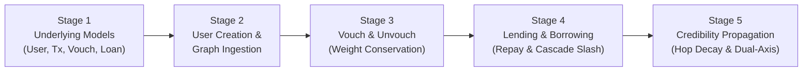

# VeriTrust — Implementation & Architecture Plan

**Status:** Implemented & Verified (All 5 Stages Complete)  
**Location:** `backend/localdocs/Implementation_Doc.md`  
**Reference:** `backend/localdocs/Init_Arch.md`  
**Design Principle:** Clean, modular, and uncomplicated. Python standard library + NetworkX + Pydantic. No smart contracts.

---

## 1. Overview & High-Level Flow

This document details the exact 5-stage implementation plan for the VeriTrust engine inside `backend/`:



---

## 2. Step-by-Step Implementation Breakdown

### Stage 1: Underlying Domain Models (`models.py`)

All models use **Pydantic v2** and strict `Decimal` for financial values and scores.

1. **`User` (Graph Node):**
   - `user_id: str` — Unique identifier (e.g. `"U001"`).
   - `name: str` — Display name / label.
   - `reputation: Decimal` — Credibility score ($R$). Initialised to $0.0$ for new users; anchors start with an initial score (e.g. $10.0$).
   - `capacity: Decimal` — Distributable vouch capacity: $C_u = \max(0, R_u)$.
   - `status: Literal["ACTIVE", "RESTRICTED", "DEFAULTED"]` — State machine status.
   - `is_anchor: bool` — Whether this node is an institutional/community anchor.
   - `financial_features: FinancialFeatures` — Income, obligations, transaction stability, data completeness.
   - `n_settled_loans: int` — Count of successfully settled loans.

2. **`Transaction`:**
   - `tx_id: str` — Unique transaction identifier.
   - `user_id: str` — Affected user.
   - `amount: Decimal` — Monetary amount in INR (always `Decimal`).
   - `tx_type: Literal["INCOME", "DEBT_SERVICE", "DISBURSEMENT", "REPAYMENT"]`.
   - `timestamp: datetime` — Timestamp of transaction.

3. **`Vouch` (Directed Edge):**
   - `vouch_id: str` — Unique vouch identifier.
   - `source: str` — Endorsing user ID ($u$).
   - `target: str` — Recipient user ID ($v$).
   - `weight: Decimal` — Allocated vouch weight $W_{uv}$.
   - `active: bool` — Status of endorsement.
   - `created_at: datetime`.

4. **`Loan`:**
   - `loan_id: str` — Unique loan identifier.
   - `borrower_id: str` — User ID of borrower.
   - `principal: Decimal` — Loan principal amount (INR).
   - `outstanding_balance: Decimal` — Current remaining balance.
   - `interest_rate: Decimal` — Decimal fraction (e.g. `Decimal("0.10")` for 10%).
   - `tenure_months: int` — Duration in months.
   - `status: Literal["PENDING", "ACTIVE", "REPAID", "DEFAULTED"]`.
   - `created_at: datetime`.

5. **`CreditAssessment`:**
   - `user_id: str`
   - `r_graph: Decimal` — Trust propagated from anchors.
   - `s_cashflow: Decimal` — Repayment capacity score from cash flows.
   - `mu_composite: Decimal` — Blended expected capacity.
   - `sigma2_epistemic: Decimal` — Uncertainty measure ($[0.0, 1.0]$).
   - `score_final: Decimal` — Lower Confidence Bound ($Score_{\text{final}}$).
   - `max_loan_limit: Decimal` — Maximum eligible loan limit (INR).
   - `contributing_paths: list[dict]` — Explainability breakdown of trust paths.

---

### Stage 2: User Creation & Graph Loading (`engine.py` / `graph_builder.py`)

1. **User Creation:**
   - `create_user(user_id, name, initial_reputation=0, is_anchor=False, financial_features=None) -> User`
   - Registers user in an in-memory user registry (`dict[str, User]`).
   - Automatically derives initial capacity $C = \max(0, R)$.

2. **Graph Ingestion:**
   - Built on NetworkX `nx.DiGraph`.
   - `add_user_to_graph(user: User)`:
     - Adds node `user.user_id` to the graph with all metadata (`reputation`, `capacity`, `status`, `is_anchor`).
   - `load_dataset(users, vouches)`:
     - Bulk loads initial nodes and edges from synthetic JSON/dictionary inputs.

---

### Stage 3: Core Feature — Vouch & Unvouch (`engine.py`)

Enforces **Out-Degree Capacity Conservation** at all times:
$$\sum_{v \in \text{Out}(u)} W_{uv} \le C_u \quad \text{where} \quad W_{uv} = \frac{C_u}{|\text{Out}(u)|}$$

1. **`vouch(source_id: str, target_id: str) -> Vouch`:**
   - **Guards:**
     - Both source and target must exist.
     - Cannot vouch for self (`source_id != target_id`).
     - Source status must be `ACTIVE`.
     - Source capacity must be positive ($C_{\text{source}} > 0$).
     - Duplicate active vouches are rejected.
   - **Action:**
     - Adds directed edge `source -> target`.
     - **Atomic Sibling Re-weighting:** Recalculates $W_{source, v} = C_{source} / |\text{Out}(source)|$ for **all** outgoing edges from `source`. Every new vouch proportionally dilutes existing vouches.

2. **`unvouch(source_id: str, target_id: str) -> None`:**
   - **Guards:**
     - Edge `source -> target` must exist and be active.
   - **Action:**
     - Removes edge from graph.
     - **Atomic Sibling Re-weighting:** If remaining $|\text{Out}(source)| > 0$, recomputes $W_{source, v} = C_{source} / |\text{Out}(source)|$ for all remaining outgoing edges. If no edges remain, no weight is allocated.

---

### Stage 4: Lending and Borrowing (`lending_service.py`)

Pure in-memory Python service — **no smart contracts or external blockchain**:

1. **`borrow(borrower_id: str, amount: Decimal, tenure_months: int) -> Loan`:**
   - **Checks:**
     - Borrower must be `ACTIVE`.
     - Calculates borrower's current maximum loan limit via `assess_credit(borrower_id)`.
     - Verifies `amount <= max_loan_limit`. Rejects if loan amount exceeds limit.
   - **Execution:**
     - Instantiates `Loan` with status `ACTIVE`.
     - Records disbursement `Transaction`.

2. **`repay(loan_id: str, amount: Decimal) -> Loan`:**
   - Reduces `outstanding_balance` by `amount`.
   - Records repayment `Transaction`.
   - **On Full Settlement (`outstanding_balance == 0`):**
     - Loan status updated to `REPAID`.
     - Increment borrower's settled loan count: $N_{\text{settled}} \leftarrow N_{\text{settled}} + 1$.
     - **Reputation Boost:**
       - Borrower reputation increases: $R_{\text{borrower}} \leftarrow R_{\text{borrower}} + \Delta_{\text{repay}}$.
       - Direct sponsors get reputation reward: $R_{\text{sponsor}} \leftarrow R_{\text{sponsor}} + \Delta_{\text{sponsor}}$.
     - Atomically recompute outbound weights for all affected nodes.

3. **`default_loan(loan_id: str) -> None`:**
   - Loan status updated to `DEFAULTED`.
   - **Atomic 4-Level Damped Slashing Cascade:**
     - **$k=0$ (Defaulter):** $R_{\text{defaulter}} \leftarrow R_{\text{defaulter}} - \delta_0$. Status $\rightarrow \text{DEFAULTED}$. Capacity frozen ($C=0$), all outbound vouch weights set to 0.
     - **$k=1$ (Direct Sponsors):** Penalty $\delta_1 = 0.5 \times W_{\text{sponsor}, \text{defaulter}} \times \delta_0$. If $R < 0$, status $\rightarrow \text{RESTRICTED}$. Sibling weights recomputed.
     - **$k=2$ (Ancestors):** Penalty $\delta_2 = 0.25 \times \delta_0$. If $R < 0$, status $\rightarrow \text{RESTRICTED}$.
     - **$k \ge 3$:** Cutoff ($\delta = 0$). Hard boundary to prevent contagion.

---

### Stage 5: Credibility Propagation & Assessment (`trust_engine.py` & `credit_engine.py`)

Straightforward, deterministic propagation:

1. **Path Traversal & Hop Attenuation:**
   - Institutional Anchors: Identified by `is_anchor=True` and $R > 0$.
   - Enumerate all simple paths from all anchors to target node $T$.
   - **Hop Decay ($\lambda = 0.5$):**
     $$\text{Trust}(P) = W_{v_0, v_1} \times \prod_{i=1}^{k-1} (W_{v_i, v_{i+1}} \times 0.5)$$
     *(First hop from anchor is unattenuated; subsequent hops attenuate by 0.5).*
   - **Cycle Absorption:**
     Each path maintains its own `visited_set`. Any attempt to loop back into an already-visited node terminates that branch with $0$ trust. (No global visited set).
   - **Graph Score:**
     $$R_{\text{graph}}(T) = \sum_{P} \text{Trust}(P)$$

2. **Dual-Axis Underwriting:**
   - **Repayment Capacity ($\mu_{\text{composite}}$):**
     $$\mu_{\text{composite}} = (0.6 \cdot R_{\text{graph}} + 0.4 \cdot S_{\text{cashflow}}) \times \exp(0.1 \cdot (N_{\text{settled}} + |\text{In}(T)|))$$
   - **Epistemic Uncertainty ($\sigma^2_{\text{epistemic}}$):**
     $$\sigma^2_{\text{epistemic}} = \frac{1}{1 + N_{\text{data}} \times \text{completeness}}$$
     Cold-start nodes with no history have $\sigma^2 = 1.0$ (high uncertainty, not negative capacity).
   - **Final Decision Score (Lower Confidence Bound):**
     $$Score_{\text{final}} = \mu_{\text{composite}} - 1.0 \times \sqrt{\sigma^2_{\text{epistemic}}}$$
   - **Max Loan Limit:**
     $$\text{Limit}_{\text{INR}} = \max\left(0, Score_{\text{final}} \times 10,000\right)$$

---

## 3. Planned Code Organization in `backend/`

```
backend/
├── localdocs/
│   ├── Init_Arch.md                      # Original briefing
│   └── Implementation_Doc.md             # This document
├── src/
│   └── veritrust/
│       ├── __init__.py
│       ├── models.py                     # Stage 1: User, Transaction, Vouch, Loan, Assessment
│       ├── engine.py                     # Stage 2 & 3: Graph state, User creation, Vouch & Unvouch
│       ├── lending.py                    # Stage 4: Borrow, Repay, Default & Slashing cascade
│       └── scoring.py                    # Stage 5: Credibility propagation & Dual-axis assessment
├── tests/
│   ├── test_models.py                    # Tests for data types & validations
│   ├── test_vouch.py                     # Tests for vouch, unvouch, out-degree conservation
│   ├── test_lending.py                   # Tests for borrow, repay, default cascade
│   └── test_propagation.py               # Tests for hop decay, cycle absorption, scoring
├── main.py                               # Simple CLI demo walkthrough of all 5 stages
└── requirements.txt                      # pydantic, networkx, pytest
```

---

## 4. Implementation Verification

All 5 core stages have been fully implemented, integrated, and verified against unit tests:
1. `models.py` (User, Transaction, Vouch, Loan, CreditAssessment, Evidence, LedgerEvent)
2. `engine.py` (User creation, Graph ingestion, Vouch & Unvouch with capacity conservation)
3. `lending.py` (Borrow, Repay, Default cascade, Settlement reputation yields)
4. `scoring.py` (Hop decay trust propagation, cycle absorption, Dual-axis underwriting)
5. `ledger.py` (Append-only SQLite + JSONL event ledger with SHA-256 hash chaining)
6. Comprehensive unit test suite (44 tests passing) and `main.py` CLI walkthrough.

