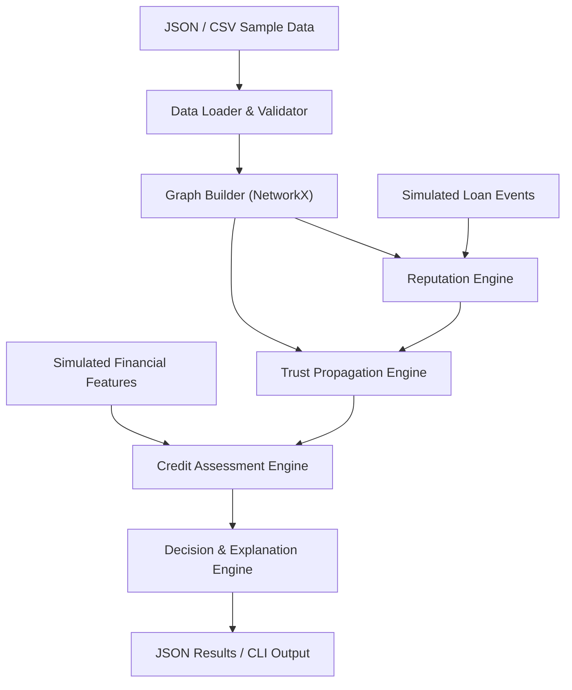

# VeriTrust — Technical Architecture (Engine POC)

**Document Type:** Historical Initial Briefing & Architecture Evolution Record  
**Status:** Implemented & Expanded to Production (see [Implementation_Doc.md](Implementation_Doc.md))  
**Original Scope:** Standalone credit-assessment engine taking a trust graph and simulated financial data, calculating reputation and trust, and producing an explainable credit assessment.

---

## 1. System Architecture

The conceptual data flow of the VeriTrust engine:



---

## 2. Technical Components & Implementation Mapping

The table below maps the original 6-hour hackathon concept to the implemented production code in `backend/src/veritrust/`:

| Initial Concept | Responsibility | Implemented Production Module | Output |
| --- | --- | --- | --- |
| `data_loader` | Load and validate users, vouches, financial features, and loan events. | `models.py`, `store.py`, `ledger.py` | Pydantic v2 domain models, JSON store, and cryptographic event stream. |
| `graph_builder` | Construct a directed graph of participants and endorsements. | `engine.py` | NetworkX `DiGraph` with out-degree capacity conservation and chronological rank decay $\alpha_{uv}$. |
| `trust_engine` | Calculate vouch weights, propagate trust, apply hop decay, and reject cyclic paths. | `scoring.py` | Hop decay $\delta^{h-1}$, per-path cycle absorption, min-path consolidation $p_u(s)$, credibility $G(u)$. |
| `reputation_engine` | Process repayments, defaults, rewards, sponsor penalties, and platform fees. | `lending.py` | 1.0% platform fee cut, repeat minting $M_k = M_0 e^{-\lambda(k-1)}$, atomic snapshot 4-level slashing cascade. |
| `credit_engine` | Combine trust, repayment capacity, and uncertainty. | `scoring.py`, `affordability.py` | Disposable income $D = I - E - B$, protected cash buffer $B$, Lower Confidence Bound (LCB) loan limit. |
| `explanation_engine` | Explain score contributions, uncertainty, and risk factors. | `explainer.py`, `audit_explorer.py` | 4-dimensional traceable explanation reports and forensic rule traces. |
| `simulation` | Generate loan events and test different graph scenarios. | `stress_tester.py`, `counterfactual.py`, `attack_simulator.py` | 5,000-run Monte Carlo stochastic stress simulations, what-if remedies, and adversarial attack tests. |
| *(Production addition)* | Optimal loan plan restructuring solver. | `optimizer.py` | Google OR-Tools CP-SAT discrete solver (`MIN_COST` vs `MAX_PRINCIPAL`). |
| *(Production addition)* | Cryptographic audit trail & disaster recovery. | `ledger.py` | Append-only HMAC/SHA-256 event ledger with deterministic state replay. |
| *(Production addition)* | Protocol platform treasury. | `lending.py`, `models.py`, `api/routes.py` | 1.0% transaction fee cut tracking on borrow and repayment via `PlatformTreasury`. |
| *(Production addition)* | Interactive REST API. | `api/` package | FastAPI REST service with OpenAPI documentation and Swagger UI. |
| *(Production addition)* | Explainable ML suite & GPU acceleration. | `backend/ml/` (`models.py`, `train.py`, `noise.py`) | EBM, XGBoost GPU, PyTorch GPU with MC Dropout, LightGBM, Calibrated Scorecard. |
| *(Production addition)* | Conformal prediction & predictive risk API. | `backend/ml/conformal.py`, `src/veritrust/prediction.py` | Split & Mondrian conformal sets ($\ge 90\%$ coverage), reason codes, and remedies. |

---

## 3. Technology Stack

| Layer | Initial Hackathon Concept | Production Implementation |
| --- | --- | --- |
| Language | Python | Python 3.11+ / 3.12+ / 3.13 |
| Graph representation | NetworkX | NetworkX `nx.DiGraph` |
| Data validation | Pydantic | Pydantic v2 with strict `Decimal` arithmetic |
| Numerical calculations | NumPy | Python standard library `Decimal` & `math` (zero floating-point drift) |
| Constraint Optimization | None | Google OR-Tools CP-SAT constraint programming solver |
| Stochastic Simulation | Prototype scripts | Seeded Monte Carlo simulation engine (5,000 runs) |
| Machine Learning | None | Explainable Boosting Machines (EBM), XGBoost GPU (CUDA), PyTorch GPU, LightGBM |
| Uncertainty & Coverage | Prototype LCB | Split & Mondrian Conformal Prediction Sets ($\ge 90\%$ finite-sample guarantee) |
| Input data | JSON / CSV | Deterministic JSON (`data/store.json`) + SQLite + JSONL |
| Cryptographic Audit | None | SHA-256 chained event ledger with replay recovery |
| Interface | CLI initially; FastAPI if time permits | Interactive CLI shell (23 commands) + FastAPI REST API |
| Testing | pytest | pytest test suite (152 tests passing) |

---

## 4. Internal Data Flow & Mathematical Invariants

### A. Graph Construction

Represent users as nodes and vouches as directed edges:

```json
{
  "user_id": "U001",
  "name": "Meena",
  "reputation": "10.0",
  "capacity": "10.0",
  "financial_features": {
    "monthly_income": "25000.00",
    "monthly_debt": "5000.00",
    "income_volatility": "0.15"
  }
}
```

Protocol identifiers are used rather than sensitive personally identifiable information.

### B. Trust Propagation

For each target borrower:

1. Identify paths originating at institutional anchor nodes ($R > 0$, `is_anchor=True`).
2. Enforce out-degree capacity conservation:
   $$\sum_{v \in \text{Out}(u)} W_{uv} \le C_u$$
3. Weight edges chronologically:
   $$\alpha_{uv} = \frac{1}{2^{r_{uv}-1}}$$
4. Apply geometric hop attenuation ($\delta = 0.5$):
   $$\text{PathTrust}(P) = \min_{e \in P} w(e) \times \delta^{h-1}$$
5. Apply per-path cycle absorption (circular loops terminate that branch with 0 trust).
6. Consolidate anchor contributions:
   $$p_u(s) = \max_{P} \text{PathTrust}(P) \quad \text{and} \quad G(u) = \sum_{s \in S} p_u(s)$$

### C. Reputation Updates & Transaction Fee Cut

The lending engine processes real and simulated lifecycle events:

```text
LOAN_DISBURSED
    → Compute 1.0% platform fee cut
    → Deduct fee from gross disbursement; credit PlatformTreasury
    → Record Transaction(fee, net_amount)
    → Commit LOAN_DISBURSED and PLATFORM_FEE_COLLECTED to ledger

LOAN_REPAID
    → Compute 1.0% platform fee cut
    → Accumulate fee in PlatformTreasury
    → Apply net repayment to outstanding principal
    → On full settlement:
        → Mint borrower reputation yield: M_k = M_0 * exp(-lambda * (k - 1))
        → Mint direct sponsor reputation reward (+1.0)
        → Atomically re-weight outbound vouches

LOAN_DEFAULTED
    → Calculate atomic snapshot penalty S_D = max(S_min, min(S_max, balance / 1000))
    → Penalize defaulter: delta_0 = S_D; freeze capacity (C = 0); status -> DEFAULTED
    → Penalize direct sponsors: delta_1 = 0.5 * W_sponsor * S_D
    → Penalize transitive ancestors: delta_2 = 0.25 * S_D
    → Hard isolation boundary at k >= 3 (cutoff prevents systemic contagion)
    → Commit events to ledger
```

### D. Credit Assessment & Lower Confidence Bound

The underwriting engine evaluates:
- Graph-derived trust $G(u)$.
- Disposable cash-flow repayment capacity $S_D = \max(0, \min(1, D / \text{threshold}))$.
- Epistemic uncertainty:
  $$\sigma^2_{\text{epistemic}} = \frac{1}{1 + N_{\text{tx}} \times \text{completeness}}$$

Final approved loan limit is derived via Lower Confidence Bound (LCB):

$$Score_{\text{final}} = \mu_{\text{composite}} - \kappa \sqrt{\sigma^2_{\text{epistemic}}}$$

$$\text{Approved Limit} = \max(0, Score_{\text{final}} \times 10,000 \text{ INR})$$

---

## 5. Implementation Evolution Summary

The original 6-hour hackathon concept has been completely fulfilled and expanded into production:
1. **Engine Foundation:** Completed in `models.py`, `engine.py`, `scoring.py`, `lending.py`.
2. **Mathematical Rigor:** Master 2026 formulation with chronological rank decay, min-path consolidation, and repeat reputation minting.
3. **Platform Treasury:** 1.0% transaction fee cut implemented and verified across all borrows and repayments.
4. **Optimization Suite:** Google OR-Tools CP-SAT optimizer and Monte Carlo stress tester in production.
5. **Cryptographic Ledger:** Append-only SHA-256 event store with complete deterministic state replay.
6. **API & Interface:** FastAPI REST service and 23-command interactive CLI shell.
7. **Verification:** 134/134 pytest unit tests passing.
