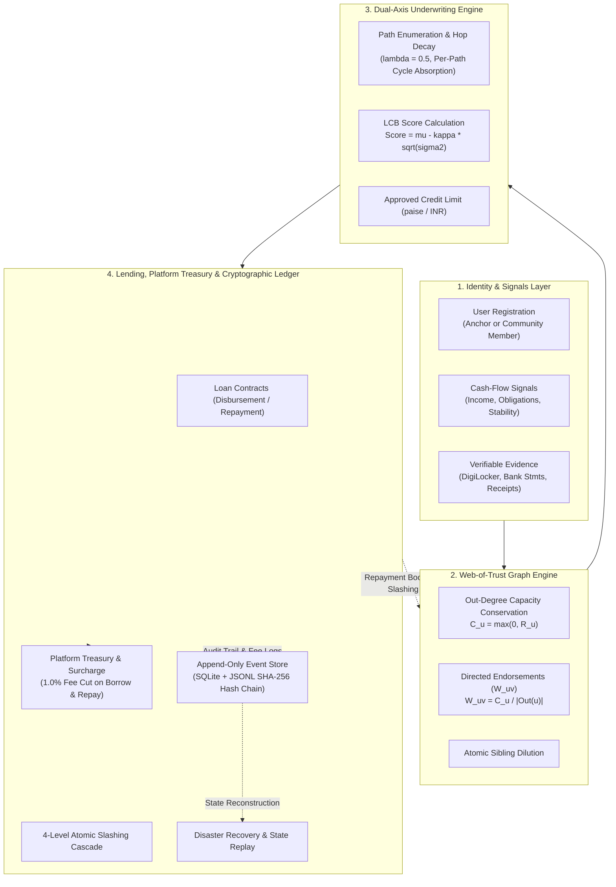
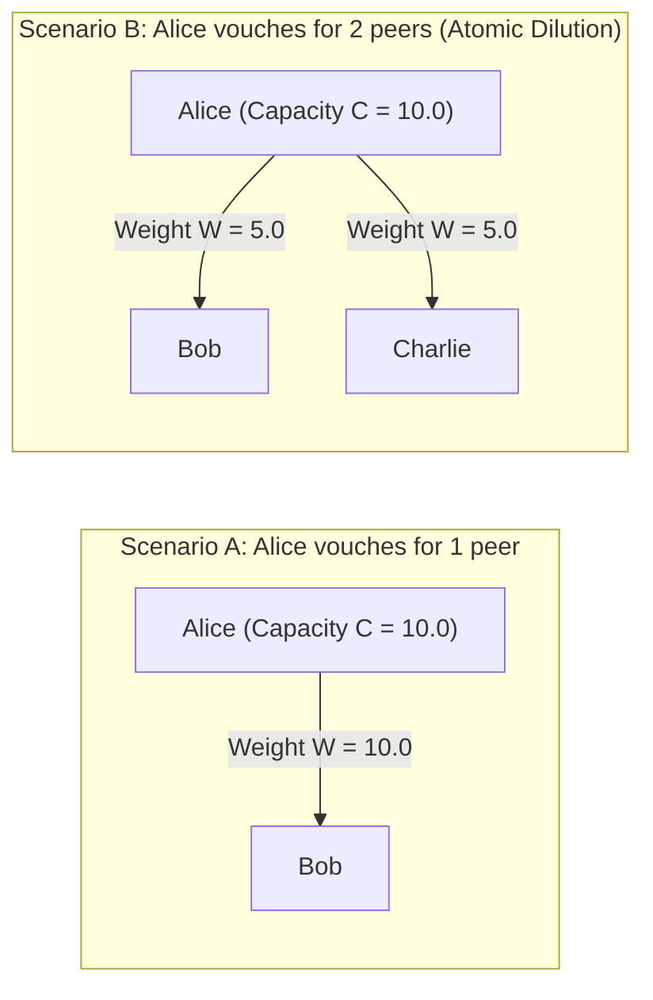
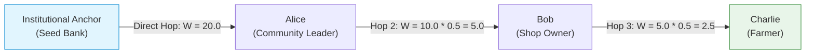
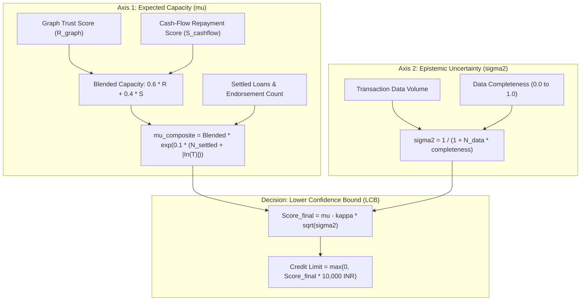
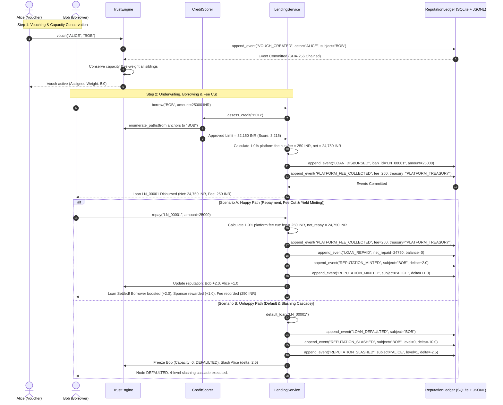
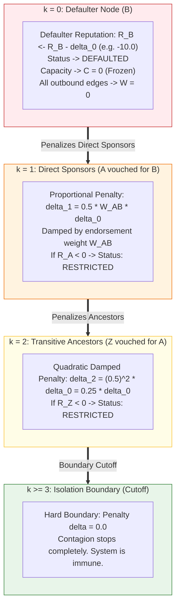
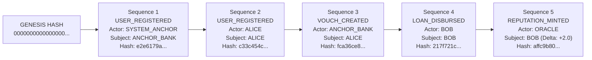

# VeriTrust — Complete End-to-End System Flow & Architecture

This document provides a clear, comprehensive, and visual walkthrough of the **VeriTrust Web-of-Trust Credit Engine & Reputation Ledger**. It explains the real-world problem being solved, the mathematical foundations, and the exact step-by-step lifecycle of a borrower in the system.

---

## 1. Executive Summary & The Problem

### The Traditional Credit Bureau Failure: The "Thin-File Trap"
Traditional credit bureaus (like CIBIL or Experian) rely entirely on past formal repayment history. 
* If a street vendor, gig worker, or rural farmer has never taken a formal bank loan, they are categorized as a **"thin-file"** or **"no-file"** borrower.
* Bureaus assign them a zero/negative score or reject them outright.
* **The fundamental mistake:** Conflating **lack of information (epistemic uncertainty $\sigma^2 \approx 1.0$)** with **bad credit risk ($R \approx -1.0$)**.

### The VeriTrust Solution
VeriTrust breaks the thin-file trap through **Dual-Axis Underwriting** backed by a decentralized **Web-of-Trust Graph** and an **Immutable Cryptographic Ledger**:
1. **Transitive Social Capital:** Local community leaders, cooperatives, or microfinance institutions ("Anchors") endorse trustworthy members. Trust propagates mathematically across network paths.
2. **Dual-Axis Underwriting:** Evaluates **Repayment Capacity ($\mu$)** on one axis and **Data Uncertainty ($\sigma^2$)** on the other axis, computing an eligible credit limit using a conservative **Lower Confidence Bound (LCB)**.
3. **Skin-in-the-Game Incentives:** Endorsing someone risks slashing your own reputation if they default, but yields a reputation reward when they repay.
4. **Verifiable Audit Ledger:** Every vouch, loan, repayment, and penalty is an immutable event in a cryptographically chained ledger with verifiable evidence.

---

## 2. High-Level Architecture Flow

The entire VeriTrust protocol is structured into four interacting layers:



---

## 3. Mathematical Foundations (Made Simple)

### Invariant 1: Out-Degree Capacity Conservation Law
In VeriTrust, you cannot manufacture trust out of thin air. A user's total ability to endorse others is strictly bounded by their own reputation score:

$$\text{Capacity } C_u = \max(0, R_u)$$

When user $u$ vouches for $k$ different peers, their capacity is divided equally among them:

$$W_{uv} = \frac{C_u}{|\text{Out}(u)|} \quad \text{such that} \quad \sum_{v \in \text{Out}(u)} W_{uv} \le C_u$$



> [!NOTE]
> **Why this matters:** A user with $10$ reputation cannot vouch for $100$ people and give each of them $10$ trust. Vouching for more people automatically dilutes each endorsement, preventing spam and Sybil collusion rings.

---

### Invariant 2: Geometric Hop Attenuation & Cycle Absorption
When trust travels along a chain from an institutional anchor to a borrower, it attenuates with distance:

$$\text{Trust}(P) = W_{v_0, v_1} \times \prod_{i=1}^{k-1} (W_{v_i, v_{i+1}} \times 0.5)$$

* **First Hop:** Full strength ($W_{v_0, v_1}$). The Anchor directly trusts Alice.
* **Subsequent Hops:** Attenuated by geometric decay factor $\lambda = 0.5$. Alice trusts Bob, Bob trusts Dave.
* **Per-Path Cycle Absorption:** If a path loops back into an already-visited node (e.g. $A \rightarrow B \rightarrow C \rightarrow A$), that specific cycle terminates with **$0$ trust**. However, other independent paths to the borrower remain valid.



---

### Invariant 3: Dual-Axis Underwriting & Lower Confidence Bound (LCB)

Instead of a single scalar credit score, VeriTrust evaluates two distinct dimensions:



#### Why LCB Protects Borrowers and Lenders
* **Thin-File / New User:** High uncertainty ($\sigma^2 = 1.0$), but **not** negative credit. They start with a modest, safe micro-limit.
* **Reputable, Well-Documented User:** High $\mu$, low uncertainty ($\sigma^2 \rightarrow 0$). The penalty vanishes and their full borrowing limit is unlocked.

---

## 4. End-to-End Walkthrough: The Lifecycle of a Borrower

Here is the exact step-by-step journey through the system from registration to borrowing, settlement, and default handling.



---

## 5. Slashing Cascade on Default: Contagion Control

When a borrower defaults, VeriTrust executes an **Atomic 4-Level Damped Slashing Cascade** to penalize reckless endorsements while strictly containing systemic contagion:



---

## 6. The Cryptographic Reputation Ledger & Audit Trail

### Events as the Source of Truth
State mutations do not happen haphazardly. The ledger is the **sole source of truth**:
1. When any mutation is triggered (e.g., `borrow`, `repay`, `vouch`), an event is appended to the ledger **first**.
2. If the ledger insertion fails (e.g., duplicate `event_id`), the in-memory graph is never touched.
3. Every event is cryptographically linked to the previous event hash, forming an unbroken SHA-256 blockchain-style hash chain:



### Audit & Disaster Recovery Commands
* **Audit (`python main.py audit`):** Verifies the mathematical integrity of every SHA-256 hash link from Genesis to Head. Detects any row tampering or broken links instantly.
* **History (`python main.py history [user_id]`):** Shows the full chronological audit trail explaining *why* someone's score changed and attaching verifiable evidence.
* **Replay (`python main.py replay --restore`):** If the database or state file is corrupted or lost, replaying all raw events from Genesis deterministically reconstructs the complete graph, reputation scores, edge weights, and loan statuses.

---

## 7. Command Reference & Hands-on Verification

You can explore and verify this entire flow using the CLI:

```bash
# 1. Inspect initial nodes and network
python main.py users
python main.py graph

# 2. Check a user's standing and credit limit
python main.py check BOB
python main.py whoami

# 3. Log in, borrow within limit, and view active loans
python main.py login BOB
python main.py borrow 5000
python main.py loans --mine

# 4. Repay the loan to trigger reputation yields
python main.py repay LN_00001 5000

# 5. Inspect the immutable audit ledger for Bob and Alice
python main.py history BOB
python main.py history ALICE

# 6. Inspect platform treasury fee collection
python main.py treasury

# 7. Audit cryptographic integrity of the hash chain
python main.py audit

# 8. Run loan optimization & stress testing
python main.py optimize 15000

# 9. Test disaster recovery state reconstruction
python main.py replay --restore
```
