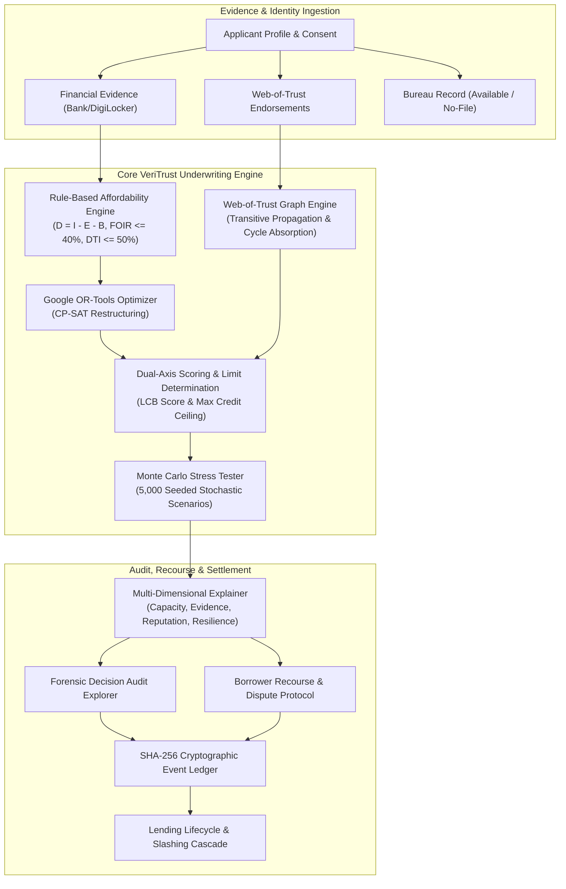
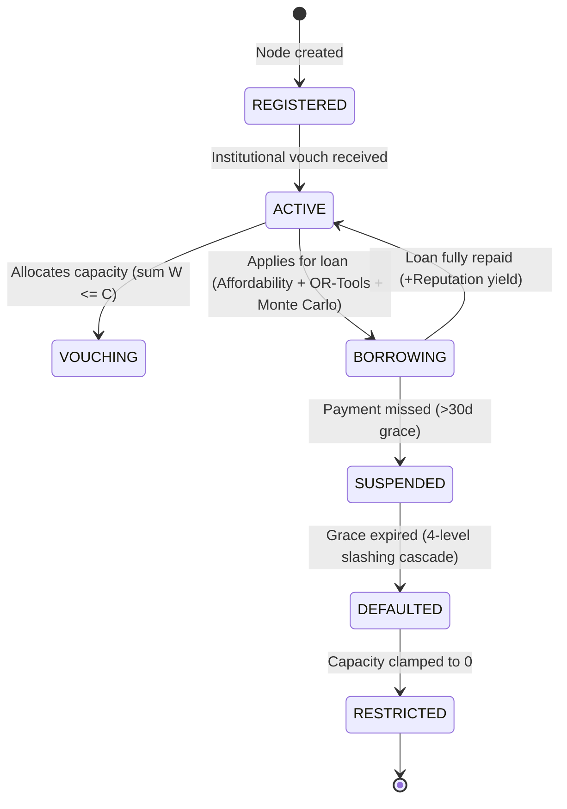

# Architecture

**Why this file exists:** a shared picture of how the pieces fit, so parallel work lines up and the pitch has a diagram ready.

## System overview

Vouch (VeriTrust) is a decentralized, explainable credit-underwriting and risk-assessment platform designed to solve the thin-file trap. It combines four orthogonal layers:
1. **Rule-based affordability engine:** Evaluates verified cash inflows, essential expenses, protected buffers, and debt caps ($D = I - E - B$).
2. **Google OR-Tools CP-SAT optimizer:** Restructures infeasible requests into mathematically optimal alternative plans.
3. **Web-of-Trust graph engine:** Transitive trust propagation with out-degree conservation, hop decay, and per-path cycle absorption.
4. **Monte Carlo stochastic stress tester:** Simulates 5,000 forward-looking economic scenarios (income volatility, payment delays, emergency shocks).
5. **Explainability & forensic audit engine:** Traces rule evaluations, evidence links, graph paths, and cryptographic event hashes.



---

## Component architecture

### 1. Ingestion and consent layer
- **Role:** Captures verified applicant declarations, consented account aggregator statements, and explicit peer endorsements.
- **Regulatory alignment:** Adheres to RBI Digital Lending Directions (2025) by requiring explicit, need-based borrower consent and object-level authorization.

### 2. Rule-based affordability engine
- **Formula:**
  $$D = I_{\text{net}} - E_{\text{essential}} - B_{\text{floor}}$$
- **Enforcement:**
  - Hard floor: Disposable income $D > 0$.
  - Fixed Obligation to Income Ratio (FOIR/ITI): $\le 40\%$.
  - Debt-to-Income (DTI): $\le 50\%$.
  - Protected cash buffer: $B_{\text{floor}} = \max(\text{₹5,000}, 0.15 \times I_{\text{net}})$.

### 3. Google OR-Tools CP-SAT optimizer
- **Role:** When an applicant's requested loan exceeds approved credit limits or monthly repayment caps, the optimizer searches the discrete $(P, T)$ grid to find the optimal feasible plan:
  - `MAX_PRINCIPAL`: Maximizes available loan capital within risk limits.
  - `MIN_COST`: Minimizes lifetime interest obligations.
- **Output:** Returns best feasible plan, monthly EMI, total interest, and binding constraints that disqualified alternative plans.

### 4. Web-of-Trust graph engine
- **Mathematical invariants:**
  1. *Out-degree capacity conservation:*
     $$\sum_{v \in \text{Out}(u)} W_{uv} \le C_u \quad \text{where } C_u = \max(0, R_u)$$
  2. *Chronological rank diminishing returns:* Incoming endorsements are weighted by immutable chronological arrival order:
     $$\alpha_{uv} = \frac{1}{2^{r_{uv} - 1}}$$
     The 1st voucher receives weight 1.0, 2nd receives 0.5, 3rd receives 0.25, rendering Sybil burst swarms mathematically ineffective.
  3. *Multi-hop path transmission:* Trust on path $P = (v_0, v_1, \dots, v_h)$ decays by node out-degrees, edge ranks, and hop attenuation:
     $$T(P) = R_{v_0} \cdot \prod_{i=0}^{h-1} \frac{1}{d_{v_i}} \cdot \prod_{i=0}^{h-1} \alpha_{v_i v_{i+1}} \cdot \delta^{h-1}$$
  4. *Same-source min-path consolidation & distinct aggregation:*
     $$p_u(s) = \min_{P \in \mathcal{P}(s, u)} T(P), \quad G(u) = \sum_{s \ne u} p_u(s), \quad G_{\text{score}}(u) = \min(G(u), G_{\text{max}})$$
  5. *Repeat transaction reputation minting:* Diminishing returns prevent transaction farming:
     $$M_k = M_0 \exp(-\lambda(k - 1)) \quad \text{with } \lambda = \ln(2) \approx 0.6931$$
  6. *Per-path cycle absorption:* Graph traversal tracks visited nodes per path branch, terminating circular loops without artificial gain.
  7. *Anchor grounding:* Trust propagates strictly from authorized institutional roots (`is_anchor=True`).

### 5. Monte Carlo stress tester
- **Role:** Tests repayment viability across 5,000 seeded stochastic economic futures over the proposed loan horizon.
- **Parameters:**
  - Income volatility: $I_t \sim \mathcal{N}(\mu, \sigma^2)$ with configurable drift.
  - Payment receipt delays: $\text{Bernoulli}(p_{\text{delay}})$.
  - Emergency expenditure shocks: $\text{Poisson}(\lambda_{\text{shock}})$.
- **Diagnostics:** Shortfall risk %, 5th-percentile adverse cash cushion, and exact income drop tolerance before insolvency.

### 6. Explanation and forensic audit explorer
- **Role:** Synthesizes actionable audit reports across four orthogonal dimensions:
  1. *Financial capacity:* Verified disposable cash flow and binding policy constraints.
  2. *Evidence reliability:* Documentation confidence and data-quality grading.
  3. *Graph reputation:* Active Web-of-Trust paths and anchor endorsement weights.
  4. *Stress resilience:* Simulated shortfall risk and emergency shock tolerance.

### 7. Borrower recourse and dispute workflow
- **Role:** Allows borrowers to contest erroneous transactions or submit updated documentation without conflating data errors with economic repayment capacity.
- **Classification:** Categorizes records as `VERIFIED`, `MISSING`, `STALE`, `DUPLICATED`, or `DISPUTED`.
- **Ledger integration:** Logs all dispute filings and resolutions as immutable SHA-256 events.

### 8. Platform treasury and transaction fee cut
- **Role:** Ensures economic sustainability for protocol operators through an automated, auditable transaction fee cut.
- **Mechanism:**
  - Configurable fee rate cut (default: $1.0\%$ / 100 bps surcharge via `PLATFORM_FEE_RATE`).
  - Recorded on every `Transaction` (`amount`, `fee`, `net_amount`) across loan disbursements and repayments.
  - Surcharge collected into a centralized `PlatformTreasury` ledger balance, verifiable via `GET /api/v1/platform/treasury` and CLI `python main.py treasury`.
  - Audited in `LOAN_DISBURSED` and `LOAN_REPAID` ledger event payloads with deterministic disaster recovery replay.

---

## State machine and lifecycle



---

## Data model relationships

```text
User (Node)
  ├── 1:N --> ConsentRecord (RBI Compliance)
  ├── 1:1 --> FinancialProfile (Income, Expenses, Debt)
  ├── 1:N --> Endorsement (Outbound Vouches)
  ├── 1:N --> LoanApplication (Borrowing Requests)
  └── 1:N --> EvidenceItem (Document Hashes)

LoanApplication
  ├── 1:1 --> Assessment (Affordability, OR-Tools, Monte Carlo)
  ├── 1:N --> RepaymentOutcome (Instalment Tracking)
  └── 1:N --> DisputeCase (Recourse Workflow)

ReputationLedger
  └── 1:N --> LedgerEvent (SHA-256 Chained Audit Trail)
```

---

## Production hardening and security

1. **Deterministic core:** Pure functions with `Decimal` arithmetic prevent floating-point drift in financial scoring.
2. **Cryptographic tamper evidence:** Every state mutation produces a cryptographically linked event hash (`prev_hash` chaining).
3. **No black-box ML:** Underwriting decisions derive from transparent, inspectable mathematical formulas and discrete constraint solvers.
4. **Regulatory readiness:** Aligns with RBI Digital Lending Directions (2025) and Fair Credit Reporting standards.
