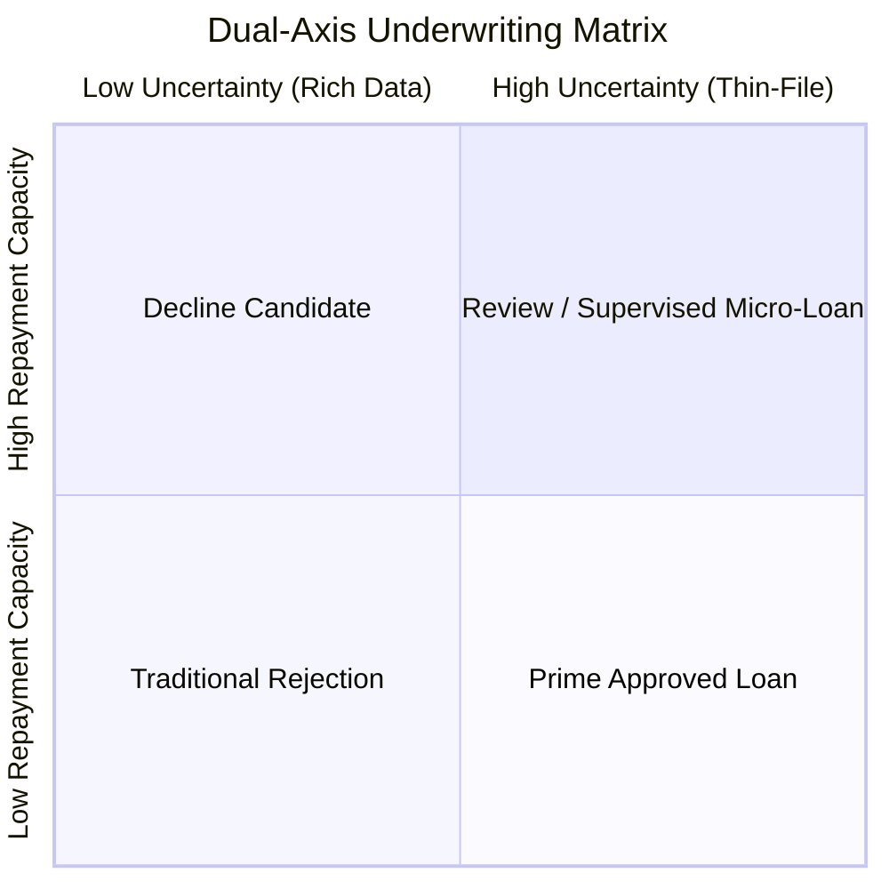
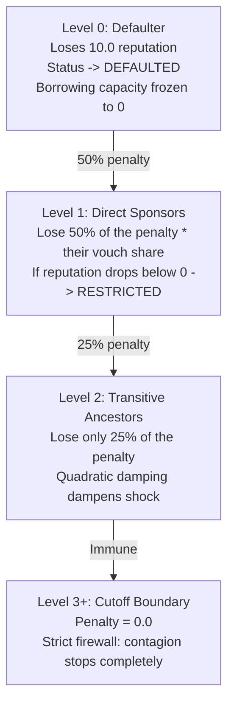

# Plain-language guide to VeriTrust formulas and rules

**Why this file exists:** explains every mathematical formula, economic rule, and safety mechanism in VeriTrust in simple, plain language for presenters, underwriters, borrowers, and hackathon evaluators.

---

## The core philosophy: why these formulas exist

Traditional credit bureaus make one fundamental mistake: **they treat lack of credit data as bad credit**. If a vegetable vendor, tailor, or small artisan has never taken a formal bank loan, their credit bureau score is zero or non-existent ("thin-file"). Banks automatically reject them.

VeriTrust replaces this black box with two transparent pillars:
1. **Real-world cash flow:** How much money actually comes in, what basic living costs must be protected, and what instalment is genuinely safe.
2. **Community trust graph (Web-of-Trust):** Who in your community is willing to vouch for you, putting their own reputation on the line.

Below is the plain-English explanation of every formula that powers this engine.

---

## 1. Trust vouches and capacity conservation

### The rule: Out-degree capacity conservation law
$$C_u = \max(0, R_u)$$

- **In plain English:** You can only vouch for others using trust you have personally earned. You cannot manufacture trust out of thin air.
- **The real-world analogy:** Think of your reputation score like water in a bucket. If you have earned 10 liters of reputation by repaying your own loans, you can pour up to 10 liters across your friends. If your bucket is empty (0 liters), you cannot pour anything.
- **Why this matters:** In scam groups, people create 50 fake accounts and have them all vouch for each other. Because fake accounts start with 0 earned reputation, their vouching capacity is strictly zero. Fake vouches carry zero weight.

### The rule: Chronological rank decay
$$\alpha_{uv} = \frac{1}{2^{r_{uv} - 1}}$$

- **In plain English:** The first person you vouch for gets your full backing. The second person gets half. The third gets a quarter.
- **The real-world analogy:** If you tell a lender, "This is my closest business partner of ten years," that carries immense weight. If you then say, "Oh, and here are 20 other people I also endorse," your endorsement naturally gets diluted.
- **The math in practice:**
  - 1st vouch: factor is $1.0$ ($100\%$ weight)
  - 2nd vouch: factor is $0.5$ ($50\%$ weight)
  - 3rd vouch: factor is $0.25$ ($25\%$ weight)
  - 4th vouch: factor is $0.125$ ($12.5\%$ weight)

### The rule: Normalized edge weight
$$W_{uv} = \alpha_{uv} \times \frac{C_u}{\sum \alpha}$$

- **In plain English:** When you vouch for multiple people, your reputation bucket is divided among them proportionally according to their rank. The total weight of all your outgoing vouches can never exceed your total reputation capacity.

---

## 2. Trust propagation across the community

### The rule: Geometric hop attenuation (50% decay per step)
$$\text{PathTrust}(P) = \min_{e \in P} w(e) \times 0.5^{h-1}$$

- **In plain English:** Trust weakens as it travels through friend-of-a-friend chains. A direct vouch from a trusted community anchor is worth 100%. A vouch through one middle person is worth 50%. Through two middle people, it is worth 25%.
- **The real-world analogy:** You trust your sister completely. You moderately trust your sister's coworker. You barely know your sister's coworker's cousin.
- **The weakest link rule:** A chain is only as strong as its weakest link ($\min w(e)$). If a bank trusts Meena with 20 points, but Meena only trusts Raju with 5 points, the trust that can reach anyone through Raju cannot exceed 5 points.

### The rule: Per-path cycle absorption
- **In plain English:** If trust travels in a circle (Alice vouches for Bob, Bob vouches for Charlie, Charlie vouches for Alice), the loop is immediately zeroed out.
- **Why this matters:** Collusion rings attempt to inflate scores by vouching in circles. VeriTrust tracks visited nodes along each path. The moment a path loops back on itself, that path's trust drops to exactly 0.0. Legitimate, straight paths from real community anchors remain untouched.

### The rule: Single-strongest path consolidation
$$G(u) = \sum_{s \in \text{Anchors}} \max \text{PathTrust}(s \to u)$$

- **In plain English:** If you have multiple connection lines coming from the same bank or cooperative, we only count the single strongest connection from that organization. You cannot game the system by creating five parallel weak accounts from the same source. If you have connections from two different institutions, their strongest paths add together.

---

## 3. Cash-flow affordability and protected living buffers

### The rule: Protected minimum cash buffer
$$B_{\text{floor}} = \max\left(2000.00, 0.15 \times I_{\text{net}}\right)$$

- **In plain English:** A lender must never lend money that takes food off the borrower's table. We lock away an untouchable living cushion equal to 15% of the borrower's income, with a hard minimum floor of 2,000.00 INR.
- **The real-world analogy:** Even if a borrower earns 30,000.00 INR and swears they can repay 15,000.00 INR a month, an unexpected medical bill or child's school fee will cause a crisis. The buffer ensures they always have emergency breathing room.

### The rule: Disposable income calculation
$$\text{Disposable Income } D = I_{\text{net}} - E_{\text{essential}} - B_{\text{floor}}$$

- **In plain English:** True repayment ability is take-home income minus real essential living expenses (food, rent, electricity) minus the protected emergency buffer.

### The rule: Regulatory policy ceilings (FOIR and DTI)
1. **Instalment cap (FOIR $\le 40\%$):** The new monthly payment cannot exceed 40% of monthly income.
2. **Total debt cap (DTI $\le 50\%$):** Existing debt payments plus the new payment combined cannot exceed 50% of monthly income.

$$\text{Max Affordable EMI} = \min\left(D - \text{Debt}_{\text{existing}}, 0.40 \cdot I_{\text{net}}, 0.50 \cdot I_{\text{net}} - \text{Debt}_{\text{existing}}\right)$$

- **In plain English:** The loan payment must satisfy both your real cash budget and regulatory safety caps. Whichever number is lower becomes the hard legal limit.

---

## 4. The dual-axis underwriting score

Traditional credit models collapse everything into one single number (e.g. 650). This fails thin-file borrowers because it mixes two completely different questions:
1. *"Can this person afford to pay?"* (Capacity)
2. *"How much data do we actually have on them?"* (Uncertainty)

VeriTrust evaluates these on two separate axes:

### Axis 1: Composite repayment capacity ($\mu_{\text{composite}}$)
$$\mu_{\text{composite}} = \left(0.6 \cdot G(u) + 0.4 \cdot S_D\right) \times \exp\left(0.1 \cdot (N_{\text{settled}} + \text{vouches})\right)$$

- **In plain English:** Measures your economic power and community standing. It blends 60% community trust with 40% verified cash flow. Every loan you successfully repay boosts your capacity by roughly 10%.

### Axis 2: Epistemic data uncertainty ($\sigma^2_{\text{epistemic}}$)
$$\sigma^2_{\text{epistemic}} = \frac{1}{1 + N_{\text{data}} \times \text{completeness}}$$

- **In plain English:** Measures how much proof we have seen. If you are brand new with zero previous bank history, your uncertainty is 1.0 (maximum).
- **The crucial breakthrough:** High uncertainty is treated as an invitation to verify, not as a badge of fraud.

### The lower confidence bound decision (LCB)
$$\text{Score}_{\text{final}} = \mu_{\text{composite}} - 1.0 \times \sqrt{\sigma^2_{\text{epistemic}}}$$

- **In plain English:** The system underwrites conservatively based on the worst-case boundary of what the data supports. As a borrower pays on time, uncertainty drops toward 0, and their borrowing limit automatically unlocks to its full potential.
$$\text{Loan Limit} = \text{Score}_{\text{final}} \times 10,000.00\text{ INR}$$

---

## 5. Temporal freshness: what happens as time passes

### The problem: The frozen vouch trap
If someone was endorsed by a community leader four years ago, does that guarantee they are creditworthy today? No. Jobs change, emergencies happen, and relationships drift.

### The rule: Multi-component half-life decay
Instead of erasing a borrower's reputation, we decay our confidence in older data:

$$C(\Delta t) = 2^{-\Delta t / H}$$

- **Bank statements:** $H = 6\text{ months}$ (Cash flow is volatile; older statements become stale quickly).
- **Peer vouches:** $H = 12\text{ months}$ (Community ties last longer, but should be reaffirmed annually).
- **Loan repayments:** $H = 24\text{ months}$ (A track record of paying debts stays credible for two years).

### What this does in practice
- Your reputation is never erased just because time passed.
- If your documents are older than 12 months, epistemic uncertainty temporarily rises.
- Uploading a fresh bank statement or having a friend reaffirm their vouch instantly restores the score to 100% freshness.

---

## 6. The 1% platform treasury

### The rule: Transparent protocol fee
$$\text{Fee} = \text{round}(\text{Amount} \times 0.01, 2)$$

- **In plain English:** On every loan disbursed and on every repayment processed, exactly 1.0% is dedicated to the platform treasury.
- **Why this matters:** Most financial technology platforms rely on venture subsidies or hidden penalty fees. VeriTrust runs on a transparent, auditable 1% micro-cut that directly finances node operators, credit audits, and community reserve pools.

---

## 7. Repayment rewards and the 4-level slashing cascade

### The rule: Diminishing repeat minting ($M_k$)
$$M_k = 2.0 \cdot e^{-0.15 \cdot (k-1)}$$

- **In plain English:** When you repay your first loan on time, you earn +2.0 reputation points. On your second loan, you earn +1.72 points. On your third, +1.48 points.
- **Why diminishing returns?** To prevent two people from taking ₹500 loans back and forth 100 times in an afternoon to artificially build an infinite credit rating.

### The rule: 4-level damped slashing cascade
What happens if a borrower defaults? Accountability must exist, but it must never destroy an entire village.

- **Level 0 (The Defaulter):** Loses 10.0 reputation points. Their account is marked DEFAULTED, and their borrowing capacity is frozen to zero.
- **Level 1 (Direct Sponsors):** The friends who vouched for the defaulter take a damped 50% hit proportional to their vouch weight. If their balance turns negative, their account is RESTRICTED until rectified.
- **Level 2 (Grand-sponsors):** Take a small 25% hit.
- **Level 3 and beyond (Firewall):** Exactly zero penalty. The contagion stops completely at 2 hops, preventing systemic collapse.

---

## 8. Google OR-Tools CP-SAT loan restructuring

### The problem with traditional banks
If you ask a traditional bank for 100,000.00 INR over 12 months, and your budget only supports an instalment for an 80,000.00 INR loan, the bank algorithm simply stamps: **REJECTED**.

### What Google OR-Tools does in VeriTrust
Instead of a binary "yes/no", VeriTrust feeds your numbers into Google OR-Tools CP-SAT (Constraint Programming - Satisfiability) solver. The solver mathematically searches over 1,500 combinations of principal, tenure, and interest rates:

1. **Candidate search:** Tries tenures from 3 to 48 months and principals from ₹1,000 to ₹200,000.
2. **Constraint verification:** Discards any combination where EMI exceeds your affordable budget or breaches the 40% FOIR cap.
3. **Optimized recommendation:** Instantly offers the borrower the exact terms that make the loan sustainable (for example: *"We cannot approve ₹100,000 over 12 months, but we can immediately disburse ₹100,000 over 18 months, or ₹75,000 over 12 months"*).

---

## 9. Monte Carlo stress testing: life-shock simulation

### The rule: 1,000 stochastic futures
$$\delta_I^* = 1 - \frac{E_{\text{essential}} + \text{Debt}_{\text{existing}} + \text{EMI}}{I_{\text{net}}}$$

- **In plain English:** We simulate 1,000 possible futures of the borrower's life across their repayment term using random sampling:
  - What happens if monsoon rains delay their income by 3 weeks?
  - What happens if an unexpected medical emergency costs ₹6,000?
  - What happens if seasonal sales drop by 20%?
- **Output:** The model calculates the exact income shock tolerance percentage ($\delta_I^*$). If a vegetable vendor can absorb a 35% decline in revenue and still service their debt without defaulting, the loan is rated **RESILIENT**.

---

## 10. Split-conformal prediction and rule-based fallback

### Split-conformal prediction sets
Instead of guessing a single prediction, the model outputs a mathematically bounded set with a **90% statistical coverage guarantee**:
- `ELIGIBLE` $\implies \{\text{REPAY}\}$: The math indicates 90%+ confidence the borrower will comfortably repay.
- `REVIEW` $\implies \{\text{REPAY}, \text{DEFAULT}\}$: Honest uncertainty. The applicant is neither approved nor rejected automatically; it is sent to a human underwriter for a second look.
- `DECLINE_CANDIDATE` $\implies \{\text{DEFAULT}\}$: On the requested terms, the borrower would be overburdened. Triggers automated counter-offers.

### Fail-safe rule-based fallback
If any machine learning component crashes, encounters corrupted weights, or times out, the backend seamlessly routes the request through `RuleBasedFallbackEngine`.
- Evaluates cash-flow affordability, DTI, bank bounces, and peer vouches using deterministic rules.
- Guarantees that the borrower never gets an unhandled HTTP 500 error, and the assessment completes with full explainability codes.

---

## Summary table of core parameters

| Parameter | Symbol | Value | Plain language meaning |
|---|---|---|---|
| **Graph share** | $\alpha$ | `0.6` (60%) | Social trust accounts for 60% of baseline capacity |
| **Cash-flow share** | $1 - \alpha$ | `0.4` (40%) | Disposable income accounts for 40% of baseline capacity |
| **Hop decay** | $\delta$ | `0.5` (50%) | Trust halves with every middle person between you and an anchor |
| **Uncertainty penalty** | $\kappa$ | `1.0` | Conservative discount applied for unverified data |
| **Cash buffer floor** | $B_{\text{floor}}$ | `15%` / ₹2,000 | Minimum protected subsistence money untouched by debt |
| **Instalment ceiling** | $\text{FOIR}$ | `40%` | Monthly loan payment cannot exceed 40% of net income |
| **Total debt ceiling**| $\text{DTI}$ | `50%` | All debts combined cannot exceed 50% of net income |
| **Platform fee** | - | `1.0%` | Sustainable protocol revenue on disbursements and repayments |
| **Slashing damping** | $\gamma$ | `0.5` (50%) | Sponsors absorb half the default penalty, ancestors absorb 25% |
| **Slashing firewall**| $k_{\max}$ | `2 hops` | Slashing never reaches beyond 2 hops; community is protected |
