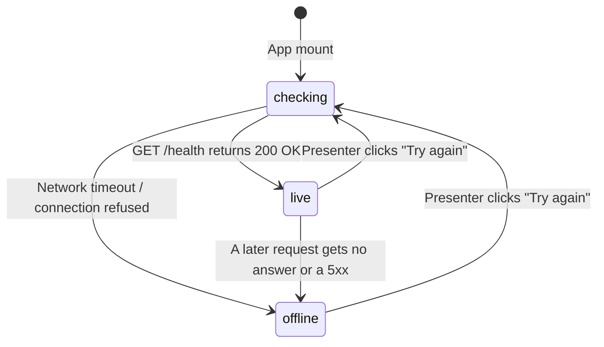

# Frontend fallback architecture

**Why this file exists:** specifies how the VeriTrust frontend maintains 100% demo continuity and interactive presentation capability in the unusual case of the backend server collapsing, experiencing network partitions, or terminating.

## Fallback principles
- Never show an error page, broken layout, or blank canvas during a live presentation.
- When the FastAPI backend answers, show live figures with a green badge. When it does not, seamlessly transition to deterministic recorded data with an amber demo-data badge.
- Probe health non-intrusively on mount and provide an explicit "Try again" trigger without reloading the browser page.
- Keep the user experience fully interactive in both live and offline states.

## Health state machine
The single source of truth for backend connectivity is located at `frontend/src/state/backendStatus.ts`. It exposes a reactive state hook `useBackend()` driven by `useSyncExternalStore`:

```ts
export type BackendState =
  | { status: 'checking' }
  | { status: 'live'; health: Health }
  | { status: 'offline'; message: string };
```



### Health check implementation
- Probe target: `GET /health` (handled by FastAPI `health_check` endpoint).
- Debouncing: In-flight requests are deduplicated via a singleton promise reference `inFlight`.
- Timeout: 5000 ms client-side timeout before declaring the server unreachable.
- Later outages: `frontend/src/api/http.ts` reports every call that gets no answer, or a 5xx (the Vite dev proxy answers 5xx when the backend is down), through `onOutage`; a live backend then turns offline. A 4xx is a refusal, not an outage: the screen shows the backend's reason and stays live.
- Re-probing: the first probe shows "Looking for the backend…" on the desk; a later "Try again" keeps the current screen in place while it checks.

## Visual status indicator
Every screen indicates the origin of displayed data using the `SourceBadge` component (`frontend/src/components/ui/SourceBadge.tsx`):

| Badge label | Badge style | Tooltip description |
|---|---|---|
| `live backend` | Green dot, active tint | Figures come from the FastAPI backend |
| `demo data` | Amber dot, paper tint | Backend not reachable: showing the built-in demo data |

The badge sits on every screen that can be live: the Assessment desk banner and each result card, the community subheader, and the lender console's live book (the story's own loan book always says "demo data"). Beside a "demo data" badge, a **Try again** button (`TryAgain` in `frontend/src/layout/ProductNav.tsx`) probes `/health` again. The dot next to "Assessment desk" in the top bar shows the same status everywhere.

## Screen-by-screen fallback behavior

### 1. Assessment desk (`frontend/src/routes/AssessPage.tsx`)
The Assessment desk runs rule-based affordability and predictive ML side by side.
- **Normal operation:** Creates an application (`POST /api/v1/applications`), runs the assessment (`POST /api/v1/applications/{id}/assessments`) and asks the model (`POST /api/v1/predict`).
- **Fallback activation:** If the backend is offline, or a call gets no answer, the desk shows the recorded run for the chosen applicant from `frontend/src/mocks/deskRecorded.ts`, with a "demo data" badge on each card.
- **Recorded corpus:** Real responses of the backend for all six applicants (Meena, Ramesh, Anand, Lakshmi, Suresh, Imran), recorded at 1,50,000 INR over 12 months at 24% with no bureau file. Other inputs need the live backend, and the desk says so.
- **What-if sliders:** When offline, they show the recorded base scenario and say the sliders need the live backend, rather than throwing an error.

### 2. Community vouching platform (`frontend/src/routes/CommunityPage.tsx`)
- **Normal operation:** Loads members and asks from `GET /api/v1/community/members` and `GET /api/v1/community/asks`; vouches go to `POST /api/v1/community/asks/{id}/vouches`, then the store reloads.
- **Fallback activation:** `frontend/src/state/communityStore.ts` starts on the seeded asks in `src/mocks/community.ts`. If a call gets no answer, or the backend turns offline, it keeps what the screens show and carries on locally, labelled "demo data".
- **Interactive capability:** Presenters can still vouch (KNOWN or EVIDENCE, always the fixed 15-point stake), choose what strangers see, post a setback and stand by or step back. State lives in memory for the presentation.

### 3. Lender console (`frontend/src/routes/LenderPage.tsx`)
- **Normal operation:** The live book reads `GET /api/v1/loans`, `GET /api/v1/platform/treasury` and `GET /api/v1/transactions`; Repay and Default call the backend.
- **Fallback activation:** The live book is replaced by one line ("Live book hidden…") with a "demo data" badge and **Try again**. The rest of the console is the guided story's own book (`src/state/DemoProvider`, `src/mocks/`), which never needs the backend.
- **Slashing demonstration:** Offline, settle and default run in the story's local simulation through the demo director (Outcome step, Regional shock).

### 4. Interactive landing page (`frontend/src/routes/LandingPage.tsx`)
- Static visualizations, research citations, and animated dataset charts (`frontend/src/features/landing/`) operate entirely client-side with no live API dependencies.
- The interactive Vouch Score builder computes real-time score updates locally in pure TypeScript.

## Backend recovery protocol
When a collapsed backend recovers (e.g. after a process restart or server reboot):
1. The presenter clicks **Try again** beside any "demo data" badge (desk banner, community subheader, lender live book line).
2. `checkBackend()` executes a fresh `GET /health` call.
3. Upon receiving HTTP 200 OK, `BackendState` switches to `{ status: 'live' }`.
4. Subscribers re-render and fetch fresh data: the community reloads from the backend, the desk reloads its applicants, and the lender console shows the live book again.

## Verifying fallback locally
To verify fallback behavior during rehearsal:
```bash
# 1. Stop any running backend processes
# 2. Run only the frontend dev server
cd frontend
npm run dev

# 3. Open http://localhost:5173/app/assess in the browser
# 4. Verify that the "demo data" badge is visible and all applicant profiles render cleanly
```
