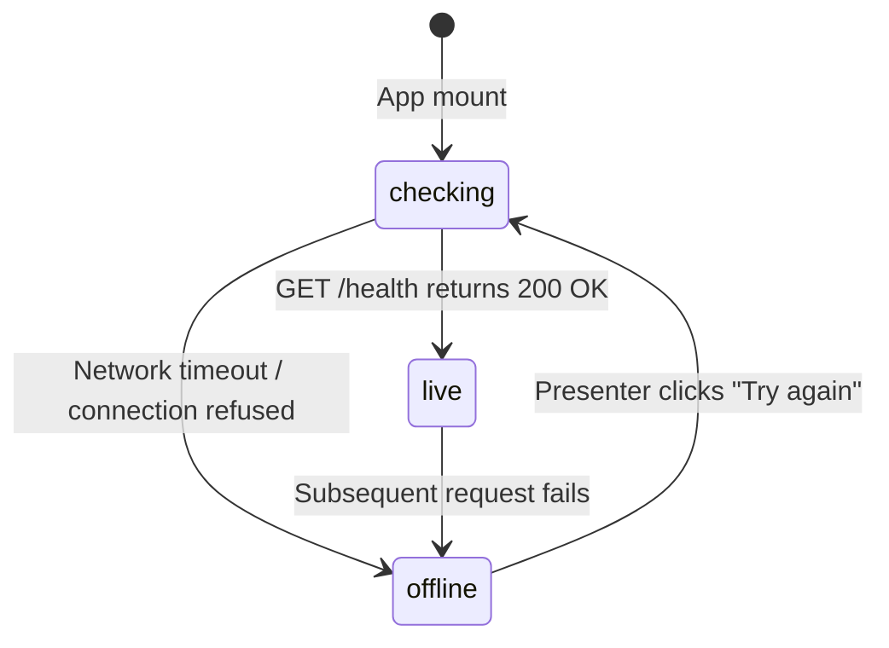

# Frontend fallback architecture

**Why this file exists:** specifies how the VeriTrust frontend maintains 100% demo continuity and interactive presentation capability in the unusual case of the backend server collapsing, experiencing network partitions, or terminating.

## Fallback principles
- Never show an error page, broken layout, or blank canvas during a live presentation.
- When the FastAPI backend answers, show live figures with a green badge. When it does not, seamlessly transition to deterministic recorded data with an amber demo-data badge.
- Probe health non-intrusively on mount and provide an explicit "Try again" trigger without reloading the browser page.
- Keep the user experience fully interactive in both live and offline states.

## Health state machine
The single source of truth for backend connectivity is located at `frontend/src/state/backendStatus.ts`. It exposes a reactive state hook `useBackend()` driven by `useSyncExternalStore`:

```ts
export type BackendState =
  | { status: 'checking' }
  | { status: 'live'; health: Health }
  | { status: 'offline'; message: string };
```



### Health check implementation
- Probe target: `GET /health` (handled by FastAPI `health_check` endpoint).
- Debouncing: In-flight requests are deduplicated via a singleton promise reference `inFlight`.
- Timeout: 5000 ms client-side timeout before declaring the server unreachable.

## Visual status indicator
Every screen indicates the origin of displayed data using the `SourceBadge` component (`frontend/src/components/ui/SourceBadge.tsx`):

| Badge label | Badge style | Tooltip description |
|---|---|---|
| `live backend` | Green dot, active tint | Figures come from the FastAPI backend |
| `demo data` | Amber dot, paper tint | Backend not reachable: showing the built-in demo data |

The badge is rendered in the top-right header across all core views so evaluators and presenters always know whether figures originate from live endpoints or recorded demo runs.

## Screen-by-screen fallback behavior

### 1. Assessment desk (`frontend/src/routes/AssessPage.tsx`)
The Assessment desk runs rule-based affordability and predictive ML side by side.
- **Normal operation:** Calls `POST /api/v1/assessments` and `POST /api/v1/predict` with selected applicant attributes.
- **Fallback activation:** If `predict()` or `assess()` throws a network error, the component catches the failure and immediately renders `recorded(borrower).predict` from `frontend/src/mocks/deskRecorded.ts`.
- **Recorded corpus:** Contains byte-identical serialized responses for standard borrowers:
  - Lakshmi (thin-file micro-entrepreneur)
  - Suresh (shocked borrower with DTI escalation)
  - Imran (collusion ring participant)
- **What-if sliders:** When offline, scenario variations compute against the recorded base rather than throwing HTTP 500.

### 2. Community vouching platform (`frontend/src/routes/CommunityPage.tsx`)
- **Normal operation:** Loads live asks from `GET /api/v1/community/asks` and submits vouches to `POST /api/v1/community/vouches`.
- **Fallback activation:** `frontend/src/state/communityStore.ts` detects backend failure and loads pre-seeded in-memory ask records (`src/mocks/story.ts`).
- **Interactive capability:** Presenters can still create an ask, adjust privacy toggles, and issue KNOWN or EVIDENCE endorsements. The browser stores state in memory for the duration of the presentation.

### 3. Lender console (`frontend/src/routes/LenderPage.tsx`)
- **Normal operation:** Retrieves live loan portfolios and platform treasury stats from `GET /api/v1/lending/treasury`.
- **Fallback activation:** Renders recorded loan books with deterministic transaction histories (`src/mocks/engine/business.ts`).
- **Slashing demonstration:** Settle and default actions execute against local in-memory simulation objects when the backend is unreachable.

### 4. Interactive landing page (`frontend/src/routes/LandingPage.tsx`)
- Static visualizations, research citations, and animated dataset charts (`frontend/src/features/landing/`) operate entirely client-side with no live API dependencies.
- The interactive Vouch Score builder computes real-time score updates locally in pure TypeScript.

## Backend recovery protocol
When a collapsed backend recovers (e.g. after a process restart or server reboot):
1. The presenter clicks the **Try again** button located on the top banner.
2. `checkBackend()` executes a fresh `GET /health` call.
3. Upon receiving HTTP 200 OK, `BackendState` switches to `{ status: 'live' }`.
4. Reactive subscribers trigger component re-renders, immediately switching badges back to `live backend` and requesting fresh data.

## Verifying fallback locally
To verify fallback behavior during rehearsal:
```bash
# 1. Stop any running backend processes
# 2. Run only the frontend dev server
cd frontend
npm run dev

# 3. Open http://localhost:5173/app/assess in the browser
# 4. Verify that the "demo data" badge is visible and all applicant profiles render cleanly
```
