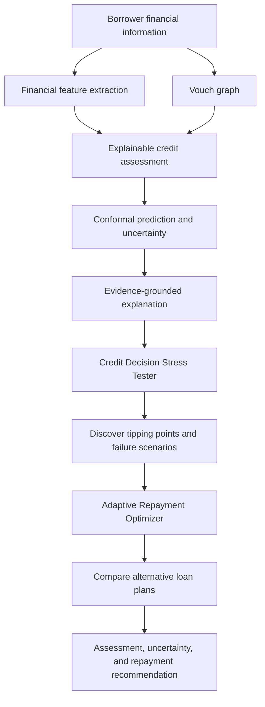
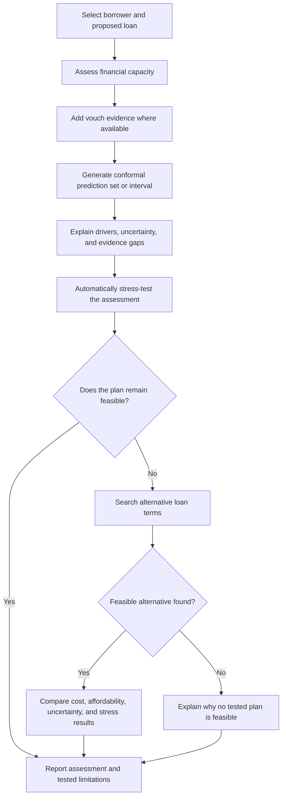

# VeriTrust

**Track:** F-04 — Fair and Explainable Creditworthiness Assessment  
**Domain:** Lending and Financial Inclusion

## Overview

VeriTrust assesses repayment capacity when financial records are limited, inconsistent, or incomplete. It combines supplementary trust evidence, explainable financial assessment, calibrated uncertainty, and loan stress testing to distinguish repayment risk from uncertainty caused by missing information.

**Core principle:** absence of financial history is not, by itself, evidence of inability to repay.

## System Architecture

## 1. Vouch — Supplementary Trust Evidence

Vouch provides additional evidence for applicants with little or no conventional credit history. Participants can vouch for others, with each sponsor's influence constrained by their available vouch capacity.

- Model endorsements as a directed graph and conserve sponsor capacity.
- Attenuate trust across longer paths and prevent cycles from creating trust from nothing.
- Update reputation using defined repayment outcomes.
- Explain which trust paths contributed to the assessment.

Vouch is supplementary evidence, not proof of repayment ability. A borrower with no vouches should not automatically receive a lower estimate of financial capacity.

## 2. Explainable ML — Financial Assessment

Assess available evidence, including:

- Income stability and cash-flow patterns.
- Existing obligations and debt burden.
- Repayment history, when available.
- Liquidity and ability to meet scheduled payments.
- Data completeness, consistency, and source reliability.

Keep **repayment assessment** separate from **evidence reliability**. Missing or unreliable information should be disclosed as uncertainty rather than silently treated as negative repayment evidence.

Use an interpretable model such as logistic regression or an Explainable Boosting Machine when suitable labelled data are available. Otherwise, use transparent calculations and clearly label their limitations. Explanations should trace to actual inputs and calculations.

## 3. Conformal Prediction — Calibrated Uncertainty

Use conformal prediction alongside the credit model to quantify uncertainty in its outputs. With an appropriate calibration set and under the required exchangeability assumptions, conformal methods can provide prediction sets or intervals with a target marginal coverage level.

- For a default-risk classifier, return a prediction set of plausible outcomes rather than forcing a single label when the evidence is ambiguous.
- For repayment or affordability estimates, use prediction intervals where the target and model support them.
- Report the selected coverage level and make clear that coverage is statistical, not a guarantee for an individual borrower.
- Where data are sparse or distributions shift, disclose that coverage may not hold; evaluate calibration on representative data before relying on it.

### Explain the uncertainty

Pair the conformal result with feature-level explanations and evidence provenance: show which observed factors influenced the underlying model, which records are missing or inconsistent, and how those gaps affect confidence in the assessment. Use scenario analysis to show what changes could move the prediction set or interval. Conformal prediction quantifies uncertainty; it does not, by itself, explain why a prediction was made or guarantee fairness.

## 4. Simulation — Stress Testing and Repayment Optimization

The simulation engine tests whether a proposed loan remains affordable under plausible changes and searches for alternatives when it does not.

### Stress testing

Automatically explore scenarios such as:

- Reduced or delayed income.
- Increased expenses or new obligations.
- Missing, duplicated, or disputed financial records.
- Different loan amounts, tenures, interest rates, and repayment dates.

Find the smallest tested change that breaches an affordability constraint or materially changes the assessment. Explain the tipping point, affected calculation, supporting evidence, and remaining uncertainty. Where useful, show whether the conformal prediction set or interval changes under the scenario.

### Repayment optimization

When the proposed loan is unsuitable, search for alternatives that satisfy defined affordability constraints. Compare payment amounts, tenure, total interest, remaining cash, and performance under stress scenarios. Begin with different principals and fixed-payment tenures; add income-aligned variable payments only when their contract and interest calculations are defined.

If no candidate meets the constraints, report that no feasible plan was found. Changing payment timing cannot make a structurally unaffordable loan safe by itself.

## End-to-End Flow

