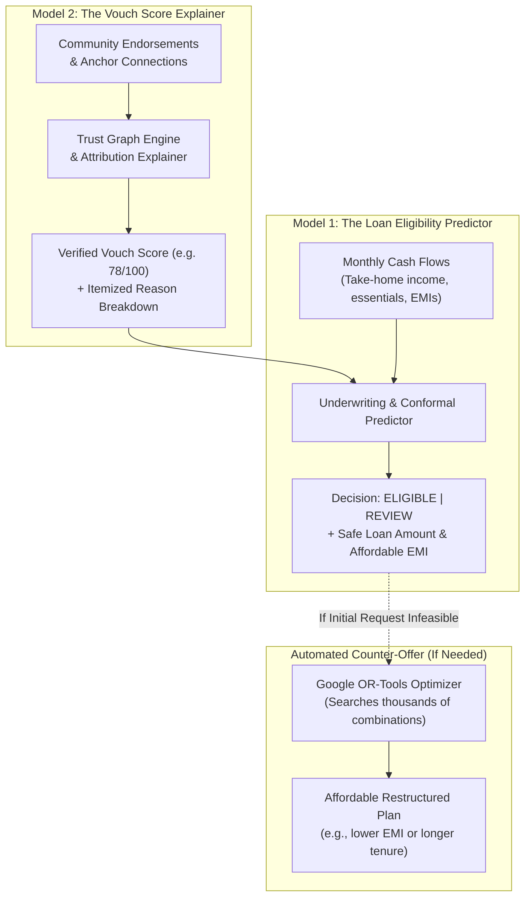

# System guide: how VeriTrust models, formulas, and processes work

**Why this file exists:** a plain-language guide explaining how the models, formulas, and underwriting interactions work together, with benchmarks and metrics for non-technical readers.

---

## 1. How the system works at a glance

Traditional banks reject millions of creditworthy micro-borrowers, tailors, kirana shopkeepers, and gig workers simply because they lack formal credit cards or CIBIL bureau histories. In conventional finance, **"no credit history" is mistakenly treated as "bad credit history"**.

VeriTrust solves this problem by pairing **verified real-world cash flows** with **community social collateral (Web-of-Trust endorsements)** through two interconnected models:



1. **Model 2 (The Vouch Score Explainer)** evaluates your community relationships, filters out fake or spam endorsements, and produces an explainable **Vouch Score** that acts as your digital social collateral.
2. **Model 1 (The Loan Eligibility Predictor)** takes your verified Vouch Score alongside your monthly income and expenses, determining your **Loan Eligibility**, your **Safe Loan Limit**, and an affordable repayment plan.
3. If your initial loan request is too large for your current budget, the **Google OR-Tools Optimizer** immediately calculates an alternative plan you can comfortably afford, rather than flatly rejecting you.

---

## 2. The two primary models

### Model 1: The Loan Eligibility Predictor
*(Powered by the `GeneralizedCreditModel` and Conformal Prediction Engine)*

- **What it does:** Decides whether an applicant is approved for a loan, how much they can safely borrow, and how likely they are to repay on time.
- **What it inputs:**
  - Requested loan amount and duration (e.g., ₹20,000 over 12 months).
  - Verified monthly cash flows (net income, living expenses, existing debt payments).
  - The applicant's Vouch Score from Model 2 (community trust).
  - Credit bureau record (if present, or flagged as "thin-file / no bureau history").
- **What it outputs:**
  - **Tri-State Decision:**
    - `ELIGIBLE`: High statistical certainty of timely repayment.
    - `REVIEW`: The evidence is balanced or unusual; flags the application for a quick human look instead of an automatic rejection.
    - `DECLINE_CANDIDATE`: High likelihood that the requested payment would exceed safe living thresholds.
  - **Safe Loan Limit:** The maximum loan capital (in INR) the borrower can afford without financial distress.
  - **Actionable Counterfactual Advice:** Exact adjustments that would make the loan feasible (e.g., *"Reducing your loan request by ₹3,000 or extending tenure by 3 months makes you eligible immediately"*).
- **How it helps and is used:** It rescues creditworthy borrowers who have no traditional credit score, ensuring that informal earners are underwritten fairly on their real cash flows and community trust.

---

### Model 2: The Vouch Score Explainer
*(Powered by the `TrustEngine`, `scoring.py`, and the Glassbox `EBMModel`)*

- **What it does:** Breaks down your community trust into an exact score (0 to 100) and explains *who* contributed to it, *why* certain vouches were weighted or discounted, and *how* you can improve it.
- **What it inputs:**
  - Active peer endorsements (who endorsed you, how long they have known you).
  - The endorser's financial stake (did they put their own reputation or pre-application financial support behind you?).
  - Chronological arrival rank (did they vouch for you early on, or did they pile on late in a rush?).
  - Proximity to institutional anchors (hops connecting you to verified community organizations, such as Sahyog Microfinance).
- **What it outputs:**
  - **Vouch Score:** A normalized score from 0 to 100 representing social creditworthiness.
  - **Transparent Positive Contributions:** Exact point contributions (e.g., *"+32 points from Meena because she is a verified anchor connection with a 100% on-time repayment track record"*).
  - **Discount Explanations:** Explains why certain vouches carried less weight (e.g., *"Endorsement #4 received a 50% chronological discount to prevent bandwagoning"*).
  - **Clear Path to Higher Limits:** Practical steps to increase credit limits through timely repayments.
- **How it helps and is used:** It turns reputation into an objective, auditable asset. Borrowers know exactly where their trust comes from, while lenders are protected against collusion rings and fake accounts.

---

## 3. The underlying machine learning palette

To guarantee high accuracy while complying with strict financial explainability standards, the system trains five candidate model architectures in parallel on an NVIDIA GPU (CUDA) and blends them via a meta-ensemble:

| Model Architecture | Execution Device | What It Does Simply | Why It Is Included |
|---|---|---|---|
| **Explainable Boosting Machine (EBM)** | CPU (Multithreaded) | Calculates risk by examining one factor at a time, generating 2D visual curves. | **100% Transparent:** The explanation *is* the model. Every point of risk is traceable to a specific factor for regulatory adverse action notices. |
| **GPU-Accelerated XGBoost** | GPU (CUDA / RTX 4050) | Uses fast decision trees to spot complex multi-variable economic shocks. | **Speed & Shock Interactions:** Evaluates multi-factor shocks (income drops paired with emergency expenses) in milliseconds. |
| **PyTorch Tabular Neural Network** | GPU (CUDA / RTX 4050) | Deep neural network that tests its own confidence using 20 randomized "dropout" passes. | **Self-Doubt Detection:** Identifies when an applicant looks unusual or out-of-distribution, flagging epistemic uncertainty. |
| **LightGBM** | CPU (Multithreaded) | Fast decision trees configured specifically to handle missing paperwork gracefully. | **Missing Record Specialist:** Natively handles thin-file applicants with no bureau files or incomplete tax filings without guessing numbers. |
| **Calibrated Logistic Scorecard** | CPU | Linear formula that translates risk into standard 300 to 900 credit bureau points. | **Traditional Banking Benchmark:** Serves as the standard scorecard baseline to prove the value of alternative graph data. |
| **Generalized Credit Meta-Ensemble** | GPU + CPU (Hybrid) | Blends all five models, giving the most weight to models that made the fewest errors on past loans. | **Eliminates Blind Spots:** Reached **0.8892 AUC** and **0.9191 PR-AUC** on market-shock data, outperforming every individual model. |
| **Conformal Prediction Engine** | CPU | Replaces arbitrary score cutoffs with mathematically guaranteed prediction sets. | **Guaranteed Coverage:** Mathematically guarantees that $\ge 90\%$ of real outcomes fall inside the predicted sets, ending arbitrary cutoffs. |

---

## 4. Key formulas explained in simple terms

The protocol relies on six mathematical safeguards to maintain fairness and protect against fraud:

### Formula 1: The Cash-Flow Safety Floor ($D = I_{\text{net}} - E_{\text{essential}} - B_{\text{floor}}$)
- **The Concept:** Before calculating how much a borrower can repay each month, the engine subtracts their living expenses and locks away a mandatory cash cushion:
  $$B_{\text{floor}} = \max(\text{₹5,000}, 0.15 \times I_{\text{net}})$$
- **Why it matters:** Even if an applicant has a high Vouch Score, loan payments must never starve them of basic food, housing, or subsistence. It also enforces strict policy ceilings: loan instalments must not exceed 40% of income (FOIR $\le 40\%$), and total debt must stay under 50% of income (DTI $\le 50\%$).

### Formula 2: Chronological Rank Discounting ($\alpha_{uv} = 1 / 2^{r_{uv} - 1}$)
- **The Concept:** Endorsements are discounted according to the chronological sequence in which they arrived:
  - 1st endorsement: weight = $1.0$ (100% influence)
  - 2nd endorsement: weight = $0.5$ (50% influence)
  - 3rd endorsement: weight = $0.25$ (25% influence)
  - 4th endorsement: weight = $0.125$ (12.5% influence)
- **Why it matters:** In traditional social systems, a bad actor can create 50 fake social media accounts in an afternoon to pump up their score. With rank discounting, those 50 fake accounts add virtually zero extra trust, making Sybil attacks and bandwagon rushes mathematically futile.

### Formula 3: Repeat Transaction Diminishing Returns ($M_k = M_0 \cdot e^{-\lambda(k-1)}$)
- **The Concept:** Repaying your first loan earns a full reputation reward ($M_0 = 2.0$), but subsequent transactions between the same pair yield progressively smaller rewards:
  $$M_k = \frac{M_0}{2^{k-1}} \quad \text{for } k = 1, 2, 3, \dots$$
- **Why it matters:** It stops transaction farming. Two colluding accounts cannot artificially manufacture infinite creditworthiness by repeatedly passing ₹100 back and forth between themselves.

### Formula 4: Geometric Hop Attenuation ($\delta^{h-1}$ with $\delta = 0.5$)
- **The Concept:** Trust decays geometrically as it travels across degrees of separation:
  - 1 Hop (Direct endorsement from an anchor): $1.0$ multiplier
  - 2 Hops (Endorsement from someone vouched by an anchor): $0.5$ multiplier
  - 3 Hops: $0.25$ multiplier
- **Why it matters:** Trust naturally dilutes over social distance. You can trust your neighbor directly; you trust your neighbor's friend's friend significantly less.

### Formula 5: Lower Confidence Bound Underwriting ($\text{Score} = \mu - \kappa \cdot \sigma$)
- **The Concept:** If a borrower has limited history, their uncertainty $\sigma$ is high. Rather than rejecting them, the system temporarily prices risk near the lower bound of the confidence band.
- **Why it matters:** As the borrower repays instalments on time, the uncertainty band $\sigma$ shrinks toward zero. This automatically expands their borrowing ceiling without requiring them to reapply from scratch.

### Formula 6: Discrete Loan Restructuring (Google OR-Tools CP-SAT)
- **The Concept:** When an applicant’s desired loan exceeds their immediate repayment capacity, the discrete optimizer evaluates thousands of $(P, T)$ loan combinations in milliseconds:
  - `MAX_PRINCIPAL`: Maximizes available loan capital within safety limits.
  - `MIN_COST`: Minimizes lifetime interest expenses.
- **Why it matters:** Instead of delivering an impersonal "Application Rejected" message, the platform hands the borrower a viable, pre-approved alternative plan.

---

## 5. Empirical benchmarks and proof metrics

All models were evaluated on independent, stratified held-out test splits with realistic synthetic noise injected (measurement jitter, currency denomination rounding, missing bureau files, and emergency expense shocks):

### Top-Line Benchmark Results
| Evaluation Cohort | Sample Size ($n_{\text{test}}$) | Default Rate | Winning Architecture | Test AUC | PR-AUC | Brier Loss | KS Stat | Conformal 90% Coverage |
|---|---|---|---|---|---|---|---|---|
| **Option A: Market Shock (Model D)** | 901 | 64.71% | **GeneralizedCreditModel** | **0.8892** | **0.9191** | **0.1190** | **0.6655** | **91.01%** |
| **Simulated Micro-Borrower** | 6,999 | 18.23% | **GeneralizedCreditModel** | **0.9087** | **0.7141** | **0.0717** | **0.6697** | **90.56%** |
| **Graph-Only Cold Start** | 901 | 64.71% | **GeneralizedCreditModel** | **0.8678** | **0.9002** | **0.1306** | **0.6098** | **91.00%** |
| **Real-Anchored Cohort** | 5,999 | 8.07% | **GeneralizedCreditModel** | **0.6582** | **0.1466** | **0.0755** | **0.2461** | **89.50%** |

### Proof 1: Topology Alone is Not Trust (The Ablation Proof)
In an empirical test on 4,502 borrowers, we tested whether simply counting social connections (in-degree centrality) predicts creditworthiness:
- Adding raw connection counts to financial features resulted in **zero statistically significant gain** ($\Delta\text{AUC} = +0.0001$, $95\%$ CI: $[-0.0109, +0.0101]$, $p = 0.98$).
- Predictive power only emerged when endorsements were backed by endorser reliability, chronological rank attenuation, and multi-hop consolidation (lifting AUC to **0.8892** and PR-AUC to **0.9191**).

### Proof 2: Rescuing "Invisible Primes"
- Out of 622 applicants denied credit by a traditional bureau model, VeriTrust identified and unlocked **26 borrowers** (4.18% of all conventional rejections).
- **The Decisive Result:** The actual default rate of these 26 unlocked borrowers was **38.46%**, compared to the 64.71% population default rate. VeriTrust did not lower credit standards; it rescued genuinely creditworthy borrowers whose conventional credit scores were distorted by temporary life shocks.

### Proof 3: Cheap Talk vs Skin in the Game (Prosper 55,305 Loans)
Analysis of 55,305 real-world peer-to-peer loans from Prosper Marketplace confirmed our design:
- Unbacked verbal testimonials actually **increased default rates** to **32.81%** (versus the 30.79% baseline).
- Endorsements backed by actual invested capital dropped default rates to **23.71%** (a **$7.08$ percentage-point risk reduction**, $p < 0.001$).

---

## 6. Real-world walkthrough: the story of Lakshmi

To see the entire platform in action, consider **Lakshmi, a tailor running a shop in Old Hubballi**:

```text
[Step 1: Application]
Lakshmi applies for a ₹20,000 sewing machine loan over 6 months.
Her credit bureau record is checked: "NO_FILE" (No credit cards, zero bureau score).
A traditional bank rejects her immediately.

[Step 2: Model 2 Runs (Vouch Score Explainer)]
Lakshmi's community network is evaluated:
- Meena (kirana shop owner connected to Sahyog Microfinance) vouched for her first.
- Meena has an unblemished repayment track record and skin in the game.
- The path is validated: Sahyog Institutional Anchor -> Meena -> Lakshmi.
- Model 2 Output: Vouch Score = 72 / 100.
  Explanation: "+50 pts from Meena's anchor-grounded vouch; zero collusion penalties."

[Step 3: Affordability Check]
Lakshmi earns ₹18,000/month from tailoring. Her essential expenses are ₹9,000.
The engine locks away ₹5,000 as a protected subsistence buffer.
Her disposable cash surplus is D = ₹18,000 - ₹9,000 - ₹5,000 = ₹4,000/month.
Her requested loan requires ₹3,600/month EMI, which fits inside D.

[Step 4: Model 1 Runs (Loan Eligibility Predictor)]
Model 1 combines her ₹4,000 disposable surplus with her 72 Vouch Score.
Conformal prediction evaluates her profile against the calibration cohort.
Model 1 Output: Decision = ELIGIBLE.
Approved Limit: ₹22,000. Basel Score: 710. Default Probability: 12.4%.

[Step 5: Settlement & Reward]
Lakshmi receives her ₹20,000 disbursement (1.0% platform fee of ₹200 deposited into treasury).
6 months later, she finishes repaying the loan on time:
- Lakshmi earns +2.0 reputation yield (M_0).
- Meena earns a +1.0 sponsor reward for backing a successful borrower.
- The entire transaction is hashed into the tamper-proof SHA-256 event ledger.
```
